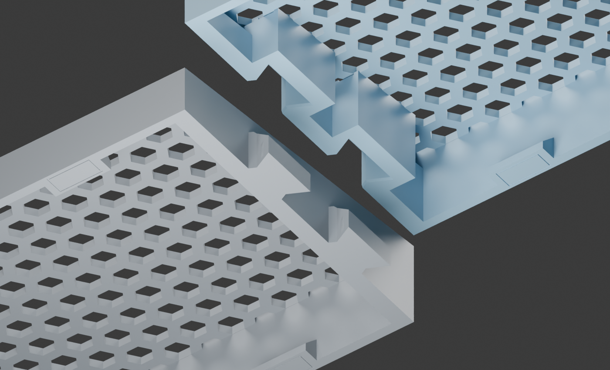
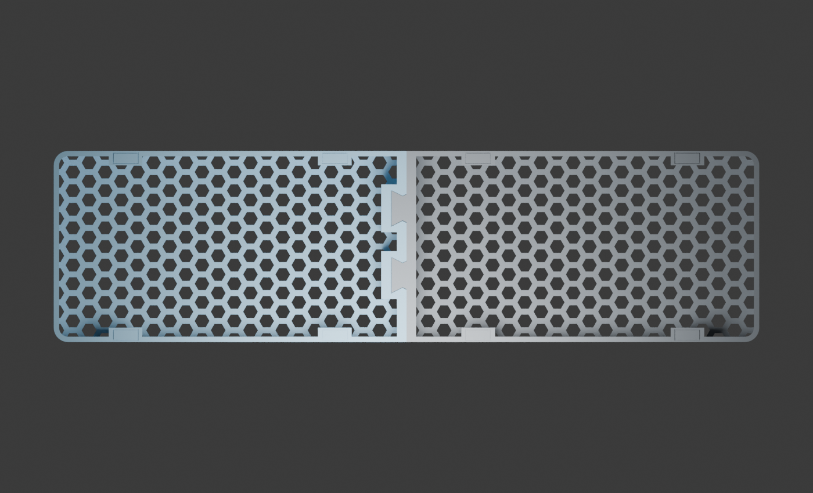
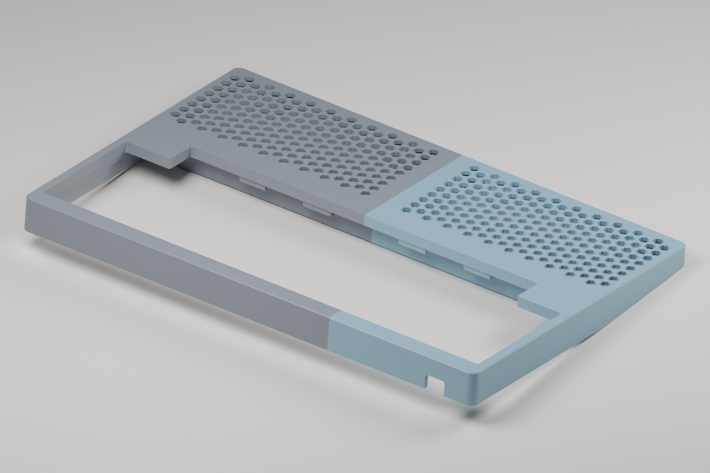
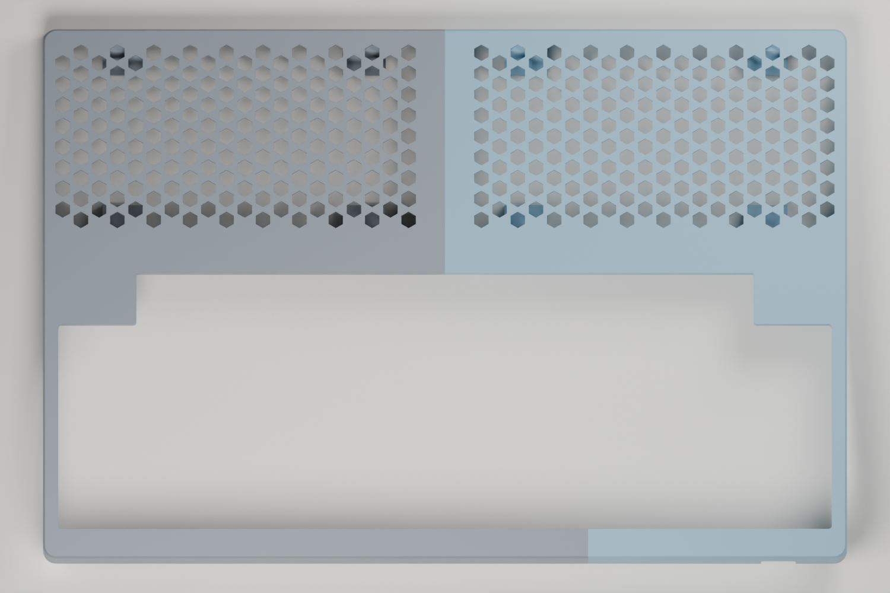
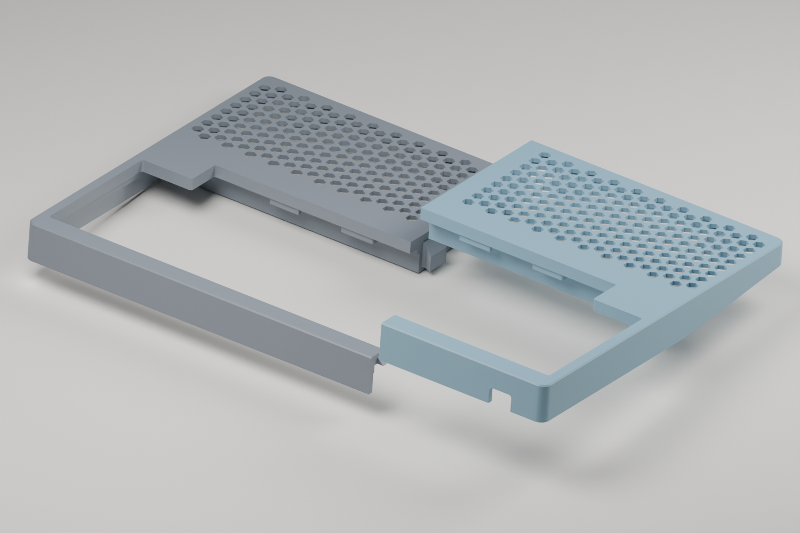
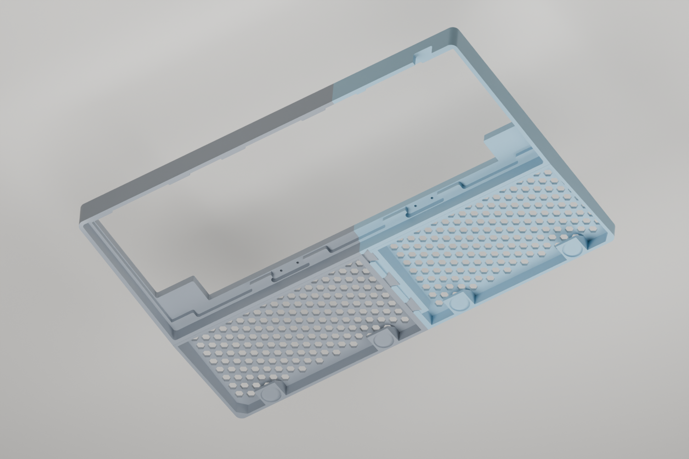

> Detailed fabrication reference preserved from the original project README.
> For the primary housing workflow, start at [Housing](housing.md); commands below
> describe the legacy fixed-directory workflow. Run all commands from the repository root.

# Rule 60 V3 Honeycomb Wrist Rest — No Extra Hardware

A code-generated two-piece wrist rest by [minpeter](https://github.com/minpeter).
Integral sliding dovetails connect the halves without screws, magnets or
separate connectors. Optional adhesive anti-slip pads are not included.

[View on MakerWorld](https://makerworld.com/en/models/3490864-rule-60-v3-honeycomb-wrist-rest#profileId-3986872)

Also in this repository: **Maru60**, an HHKB housing for the Rule 60 V3's
internals with this wrist rest built in: an experimental
[top case](#maru60-hhkb-top-case-with-integrated-wrist-rest-experimental) and a
[draft bottom case](#maru60-hhkb-bottom-case-draft).



## Download and print

**Current version: tight fit.** The owner printed the male joint coupon and
confirmed a very tight, fully seated fit with the existing receiver. The full
replacement body is being printed; full-body strength and long-term retention
have not been validated.

| File | Use |
| --- | --- |
| [Full wrist rest — 3MF](../models/rule60-v3-wrist-rest/rule60-v9-honeycomb-body.3mf) | Both current halves on one plate |
| [Left / male — STL](../models/rule60-v3-wrist-rest/left.stl) | Replacement male half |
| [Right / female — STL](../models/rule60-v3-wrist-rest/right.stl) | Receiver half |
| [Both halves — STL](../models/rule60-v3-wrist-rest/rule60-one-plate.stl) | Combined print plate |
| [Male-only replacement — 3MF](../models/rule60-v3-wrist-rest/rule60-tight-fit-left.3mf) | Reuse an existing v9 receiver |
| [Male-only fit coupon — 3MF](../models/rule60-v3-wrist-rest/rule60-tight-fit-test-left.3mf) | Test against your existing receiver first |
| [Two-joint fit test — 3MF](../models/rule60-v3-wrist-rest/rule60-v9-joint-test.3mf) | Print both sides of the joint test |
| [Surface and pad sample — 3MF](../models/rule60-v3-wrist-rest/rule60-v9-surface-pad-test.3mf) | Surface feel, adhesion and pad placement |

The wrist-rest downloads live in `models/rule60-v3-wrist-rest/` (they were in
`models/` until the Maru60 housing joined this repository). The `rule60-v9-*`
file names are retained, but the body and joint-test files now contain the
tight-fit revision. Older geometry remains in Git history. The surface sample
is unchanged.

Repository 3MFs contain **geometry only**, not printer settings or G-code.
Keep the supplied orientation: the sloping wrist-contact surface faces the
build plate. Re-slice for your printer, nozzle, filament and plate. MakerWorld
also provides a Bambu Studio print profile with the updated geometry.

Body: **295 × 80 × 21 mm**. Eight optional **10 × 4 × 1 mm** adhesive pads
give approximately **22 mm** installed height. The body has 2.4 mm honeycomb
ribs, a 2.2 mm skin and 0.2 mm aperture-edge relief, without X ribs or weight
inserts. Dimensions follow the owner's measured Rule 60 V3 front edge;
compatibility with other keyboard cases is not guaranteed.

## Fit and assembly

The male mating faces are expanded **0.20 mm** to close the original nominal
gap, with four rounded compression ribs adding **0.10 mm per flank** locally.
The v9 receiver interface is unchanged. This is **friction retention, not a
latch**: printing variation, wear and PETG creep can change the holding force.

Place the left half on a flat surface. Align the right half above both tongues,
then lower it evenly into place. Do not force the halves together horizontally
or hammer them. Test the coupon in the same material and settings first; a
successful fit should seat fully without cracking or damaging either half.

Already have a v9 receiver? Print only the male coupon, then the replacement
left half. **Do not combine the enlarged male with the smaller sockets from
the experimental `--clearance 0` revision.** Support both halves when carrying.

Attach equally thick pads inside all eight marked outlines, without covering
the bottom-open sockets. The outlines are not recessed pad pockets.



## Slicing

The updated MakerWorld profile preserves the owner's **X2D / 0.4 mm nozzle,
Bambu PETG Translucent, 0.20 mm layers, 3 walls, 15% infill and no supports**.
Its estimate is approximately **4.1 hours / 72 g**, not a measured completed
print time. Select your own printer, filament and build plate before slicing.

Inspect first-layer adhesion, dovetail overhangs, compression ribs and pad
ledges in the layer preview. The CLI slice completed but reported ZFiller and
reserved-tool-command diagnostics; their impact remains unresolved. A
successful CLI exit does not prove every toolpath is correct. Do not enable
supports inside the mating sockets without checking removal access.

## Reproduce and continue designing

Install [uv](https://docs.astral.sh/uv/), clone the repository, then run:

```sh
uv sync --locked
# Original receiver and no-rib comparison baselines for verification:
uv run build.py 2.4
uv run build.py 2.4 --male-expansion 0.20
# Current published fit:
uv run build.py 2.4 --male-expansion 0.20 --compression 0.10
uv run verify.py rib-2.4-male-expanded-0.20-compression-0.10
uv run export.py
```

`build.py` constructs the geometry in code and reads no external STL or 3MF.
Outputs are in the ignored `rib-2.4-male-expanded-0.20-compression-0.10/`
directory. `rule60-one-plate.3mf`, `replacement-left.3mf`,
`replacement-test-left.3mf` and `test-joint-plate.3mf` correspond to the
downloads above. STL exports use millimetres.

`export.py` refreshes `models/rule60-v3-wrist-rest/` and the verification evidence. Published STLs
are binary: export removes triangles that collapse at float32 precision, then
checks closed meshes, component counts, dimensions and volume after reload.
This avoids degenerate faces when MakerWorld converts ASCII STL downloads.

The default command without fit options intentionally reproduces the original
looser v9. `--male-expansion 0.20` without `--compression` provides a no-rib
control. Other supported compression values are `0` and `0.05`; fit changes
require a new coupon test. Do not globally scale a part to adjust the joint.

For optional CAD renders, install Blender separately:

```sh
blender -b --python render.py -- rib-2.4-male-expanded-0.20-compression-0.10
```

`uv.lock` pins geometry/check dependencies. Blender and Bambu Studio are
external applications. Private printer configuration, raw logs and caches
are not included; save your own slicer project for repeatable printing.

## Verification and limitations

[Current verification](../evidence/verification.json) checks closed connected
meshes, dimensions, plate bounds, 89 insertion positions, intentional contact
confined to the compression ribs, an unchanged receiver, root and entry
geometry, aperture relief, pad heights and layer-section connectivity.
[Current dimensions](../evidence/dimensions.json) record the fit parameters.

These checks do not simulate deformation, insertion force, wear, creep or
full-body stiffness. The owner's coupon test confirms fit for their print,
not a universal tolerance guarantee. CAD images are illustrations, not proof
of physical strength or transparent PETG appearance. The overview images
predate the small compression ribs. Automated visual review of the latest
renders was unavailable due to an image-upload quota.

[Historical rib comparison](../evidence/rib-comparison.json) covers the original
v9 candidates, not the current tight-fit slicing estimate.

## Maru60 HHKB top case with integrated wrist rest (experimental)

**Maru60** is an HHKB housing for the Rule 60 V3's internals with the
honeycomb wrist rest built in. The name is 마루 (*maru*), the raised wooden
porch along a Korean house where you sit and rest. Its top case reuses the
stock Rule 60 V3 bottom case (or the Maru60 bottom case below), PC gasket
plate, 12 silicone gasket caps and four ball-catch strike plates. The case
outline and Z levels follow the owner's caliper measurements of the stock top
case; the gasket-cap and ball-catch pockets follow photo metrology of the same
part.

**License: [CC BY-NC 4.0](../LICENSE-topcase)**, personal and other non-commercial
use only (the wrist rest above stays CC BY 4.0; see
[License](#license-and-design-history)).

| Assembled | Top |
| --- | --- |
|  |  |
| **Exploded** | **Underside** |
|  |  |

Renders are CAD illustrations (left half grey, right half blue), not print
photos.

**Status: test-fitted in print.** The owner's v7.4 print (both halves)
assembles on the stock bottom case, plate and gaskets, and the joints fit well.
On the desk the wrist rest sits slightly high and creaks when pressed, most
likely because the stock bottom-case feet hold the keyboard about 2 mm above
the desk (estimated, not measured) while the model puts the wrist-rest
underside level with the top-case lip. Bumpons under the wrist rest fill that
gap. v7.6 adds bumpon pockets, v7.9 sets the USB-C notch from public PCB
data, v7.10 keeps only the front pad row, v7.11 widens the notch to 14.75 mm and
v7.12 moves it to the PH60 Rev.3 default board; none has been printed yet. Fixes
found by printing:

- **v7.0:** v6.2 and earlier printed the mirror image: the DWG plate frame is a
  top view, the print frame the underside. The USB-C notch came out on the
  wrong side and the two outer back gasket pockets sat ~10 mm off their tabs.
  The verification now checks the USB-C side and the inward back-left pocket.
- **v7.1–v7.3:** bottom-case pocket corners R5.0 → R2.0 (the R5.0 held the
  stock bottom case ~2.3 mm off at the corners); outer corners R8.0 → R4.85,
  concentric with them; USB-C notch 12.8 mm wide with R1.5 corners, from the
  stock notch photographed against the print.
- **v7.4:** USB-C notch 8.7 mm deep from the lip.
- **v7.5 (not printed):** the eight bumpon pads run 11 mm instead of 6 mm in,
  so a 3M Bumpon SJ5302 (Ø7.9 mm) sits wholly on its pad instead of hanging
  ~1 mm past the front face.
- **v7.6:** the pads take the flat-top 3M Bumpon SJ5012 (Ø12.7 × 3.5 mm)
  instead: 16 × 16 mm pads, each with a Ø13.6 × 1.5 mm pocket square to the
  desk, so the bumpon stands 2.0 mm proud and the pocket wall resists sideways
  push. Past ~6 mm each pad is a 45° corbel (no supports).
- **v7.7 and v7.8 (superseded):** the USB-C notch moved by eye on the owner's
  print, 2 mm outward and then back to the stock position.
- **v7.9:** the notch follows public data only: the 6095 tri-mode kit PCB
  (then the default board) measures plate X 18.45 in top-side photos, 0.9 mm toward
  the Esc-side edge of the stock notch (19.35).
- **v7.10:** only the four front bumpon pads remain. On the printed bottom
  case the back row along the keyboard junction stood 24 mm in front of the
  bottom case's own front bumpons, so the assembly stood on 14; the front row
  and the bottom case's four corners (8 in all) carry every load case.
- **v7.11 (not printed):** the USB-C notch is 14.75 mm wide instead of the
  stock 12.8 (`top.usb_notch_cable_width` in `spec/rule60-v3.json`; set it to
  12.8 for the stock width). The stock width left 0.22 mm per side for a
  12.35 mm USB-C plug, less than the ±0.3 mm photo reading of the board's
  connector centre.
- **v7.12:** the default board is the [PH60 Rev.3 Multi](#pcb), whose KiCad
  file puts the USB-C at plate X 18.65, 0.2 mm further from the Esc-side edge
  than the 6095 tri-mode kit PCB. The 6095 right half stays published as the
  cheaper option.

[Fit photos](../evidence/topcase/README.md#photos) are in the evidence folder.

| File | Use |
| --- | --- |
| [Left half — 3MF](../models/maru60-hhkb-topcase-left.3mf) | 206 × 197 mm print, 4 h 16 min / 76 g |
| [Right half — 3MF](../models/maru60-hhkb-topcase-right.3mf) | 149 × 197 mm print, 3 h 48 min / 65 g; 14.75 mm USB-C notch centred on the PH60 Rev.3 PCB (the default board) |
| [Right half, 6095 tri-mode USB — 3MF](../models/maru60-hhkb-topcase-right-usb-6095-trimode.3mf) | Same 14.75 mm notch, centred on the 6095 tri-mode kit PCB, the [cheaper option](#pcb) ([verification](../evidence/topcase-verification-usb-6095-trimode.json)) |
| [Right half, universal USB — 3MF](../models/maru60-hhkb-topcase-right-usb-universal.3mf) | Same 14.75 mm notch, centred on the spread of every measured on-board USB position in [Interface spec and PCB boards](#interface-spec-and-pcb-boards) ([verification](../evidence/topcase-verification-usb-universal.json)) |
| [Fit coupons — 3MF](../models/maru60-hhkb-topcase-fit-coupons.3mf) | Front-left corner, front joints and back seam |

Assembled: **298.1 × 198.3 mm**, 20.01 mm case height. The halves split at the
centre through the wrist rest and front bezel, joined by three sliding
dovetails with compression ribs. The back bezel continues on the left half to
the back-left ball-catch strike (the one nearest the USB-C side of centre),
whose stock plate bridges the back seam with one M2 screw in each half; a wedge
key aligns that seam. Every joint side face
is line-to-line (0 mm); the dovetail landings and the faces under each 45°
print ramp keep a 0.20 mm vertical glue line. Use epoxy or gel cyanoacrylate.
Strike-plate screws must not exceed **5.0 mm under the head** (1.45 mm plate +
3.55 mm pilot).

**Bumpons:** four **3M™ Bumpon™ Protective Products SJ5012** under the wrist
rest (four more go under the bottom case's corners): cylindrical,
flat top, Ø12.7 × 3.5 mm (±0.5 mm), black, white, grey or brown. The same
shape is sold as **SJ5312** (transparent) and **SJ5412** (true white); any of
the three fits ([3M datasheet](https://multimedia.3m.com/mws/media/117314O/3m-bumpon-protective-products-molded-shapes-colored-and-clear.pdf)).
Press one into each pocket along the wrist rest's front edge. Each stands
2.0 mm proud of the pad, to fill
the ~2 mm the stock feet lift the keyboard (estimated, not measured). The
hemispherical **SJ5302** (Ø7.9 × 2.2 mm, transparent; SJ5302BL is its
80-piece blister pack) does not suit the pockets: it would stand only 0.7 mm
proud.

**Gasket caps:** the stock caps are sold separately as Keebox **Silicone
Gaskets, 20 pcs** ([AliExpress 1005008463912507](https://www.aliexpress.com/item/1005008463912507.html)):
a semi-clear U-sock with a rounded end, 8 × 5 × 5 mm, with a 6.5 × 2.8 × 1.2 mm
slot for 1.2–1.6 mm plates. Push one fully onto each end of the six plate tabs
(12 in all). Pushed fully on, a cap clears the pockets of both printed cases by
0.02–0.05 mm. The 3.90 mm gap between the two seats squeezes each 1.9 mm flange
by 0.70 mm; a stock case measures about 4 mm (one owner's reading).

### Printing

Print each half on its own plate in the supplied orientation, top face on the
plate, without supports or brim. The owner's settings: X2D / 0.4 mm nozzle,
Bambu PETG Translucent, 0.20 mm Standard, 3 walls, 15% infill, textured PEI,
default 0.15 mm elephant-foot compensation. The textured plate forms the
visible top surface.

These 3MFs include a Bambu Studio / Orca **height-range modifier: 0.10 mm
layers from Z 5.4 to 10.0 mm**. At 0.20 mm the 6.30 mm gasket-cap floor
prints at 6.4 and the 9.69 mm bottom-case seat at 9.6, pinching the caps
0.19 mm more; with the range they print at 6.3 and 9.7. Confirm the range in
the object list after opening. Bambu Studio CLI estimates (v7.6, same right
half as v7.8): left 4 h 25 min / 78 g, right
3 h 57 min / 67 g; coupons (unchanged since v7.4) 1 h 47 min / 33 g. The CLI
slice reported ZFiller diagnostics.

### Interface spec and PCB boards

Every value a compatible part has to match lives in [`spec/`](../spec), with its
status (caliper, photo, fit, drawing, datasheet, derived, assumed) and source:

- [`spec/rule60-v3.json`](../spec/rule60-v3.json): stock top case, plate tabs,
  gasket caps, ball-catch strikes, keycap gauge, battery bay, bumpons.
- [`spec/rule60-v3-outlines.json`](../spec/rule60-v3-outlines.json): plate
  outlines, the 8 top-mount holes, the battery-bay filler and the back
  decoration plate, extracted from INKC STUDIO's
  [`rule60-v3.dwg`](../third_party/inkc-rule60-v3/README.md), which is
  redistributed here with its provenance.
- [`spec/boards.json`](../spec/boards.json): GH60 reference geometry (285.0 ×
  94.6 mm, holes, USB) and 143 GH60-class boards surveyed from design files,
  vendor drawings, product photos and Rule 60 owner reports. A GH60-grid PCB
  maps into the plate frame as `X_plate = X_gh60 + 0.4525`,
  `Y_plate = 101.068 − Y_gh60`.

`build_topcase_draft.py` and `verify_topcase.py` read these files. The PCB's
USB position sets the notch, chosen with `--board` (any board id with a USB
position, or `universal`):

| `--board` | Notch centre, plate X | Basis |
| --- | --- | --- |
| `ph60-rev3` (default, published files) | 18.65 | PH60 Rev.3 Multi KiCad file, USB-C footprint centre |
| `6095-trimode` (published top-case right half and bottom-case left half) | 18.45 | 6095 tri-mode kit PCB, top-side photos (±0.3) |
| `rule60-kit-6095` / `yr6095` | 18.55 | Y&R 6095 wired kit PCB, three top-side photos (±0.3); the stock notch at 19.35 sits 0.8 mm right of it |
| `gh60` and most open designs | 18.65 | GH60 rev C KiCad, 18.2 mm from the PCB edge |
| `wish60-ble` | 19.12 | Maker's STEP, mid-mount USB-C |
| `wooting-60he` / `venom-60he` | 19.11 / 19.10 | Vendor 3D models |
| `ae61-pro` (highest found) | 19.45 | Photo (±0.5) |
| `universal` | 18.48, 14.75 mm wide | Every measured on-board back-edge USB below (guesses left out) |

**Survey result** (2026-10-31): 144 boards, 79 open designs and 61
commercial; 117 have a USB position, 69 of them from design files. Two
oshwhub projects behind the EasyEDA Pro login (HL6095, OPEN60), 13
AliExpress and 10 Taobao listings were captured with the Aside browser and
measured. An audit re-parsed 36 design files (29 matched within 0.005 mm,
the rest were corrected), re-measured every uncertain photo value and merged
duplicates.

| Verdict | Boards | Meaning |
| --- | --- | --- |
| fits | 75 | On-board USB at the back edge, GH60-size outline, MX plate |
| check | 57 | Daughterboard-only USB (needs a case mount), HE/EC/Alps plate and mount, or an outline larger than GH60 |
| unknown | 5 | No USB position found (XD60 rev3, Basic IO F60, PieStar64 and two Taobao boards) |
| no | 7 | USB on another edge, outline far larger than GH60, or low-profile switches |

On-board USB centres range from 17.50 (1up60rgb, photo) to 19.45 in plate
X; design files cluster at 18.65. "6095" names a layout, not one PCB: the
wired Y&R 6095 and the 6095 tri-mode kit boards are different designs whose
connectors still agree within 0.3 mm. Every surveyed connector sits on the
PCB bottom side or mid-mount, which the notch depth suits. `fit.reasons`,
per-board sources and 51 owner reports from Rule 60 builds are in
`spec/boards.json`. The universal right half covers every board that is not
`no` and has a measured on-board USB position. Between boards only the top
case's right half and the bottom case's left half change. The universal notch
has no bottom-case half yet: with it, the bottom-case slot stays the default
board's 12.8 mm.

### Reproduce

The build is Python only: [manifold3d](https://github.com/elalish/manifold)
mesh CSG in the same CNC order as the stock part, about 2 s per board. It used
to drive the SolidCraft v0.22.0 CLI (about 24 min a build); the manifold3d
build matches that geometry within 0.045 mm (finer tessellation of the arcs:
corners, keycap-opening fillets, screw pilots) and gives the same check values.
No CAD (STEP) file is published.

```sh
uv run build_topcase_draft.py [--board BOARD] [--strike-inserts | --no-strike-inserts]
uv run verify_topcase.py
blender -b -P render_topcase_draft.py   # optional renders
uv run export_topcase.py
```

#### Optional upper strike inserts (CANOT OD3.5 × L3 trial)

Choose `--no-strike-inserts` (the default) for the original Ø1.8 mm screw
pilots, or `--strike-inserts` for the latest original-contour upper with eight
Ø3.2 mm **trial** insert bores. Both keep the original mushroom pockets,
rounded rails, alignment key, 13 mm hole pitch, 5.55 mm seats, 3.55 mm blind
depth and 2.00 mm skin. No extra scallops, pads or purchased-catch layout are
enabled. This option changes **only the upper**, not the lower catch mounts.

```sh
# Original screw pilots
uv run build_topcase_draft.py --no-strike-inserts
uv run verify_topcase.py
uv run export_topcase.py

# Same design, CANOT insert trial holes
uv run build_topcase_draft.py --strike-inserts
uv run verify_topcase.py
uv run export_topcase.py
```

The insert files and evidence use a separate `-canot-inserts` suffix, e.g.
`models/maru60-hhkb-topcase-left-canot-inserts.3mf`; they do not replace the
original downloads. A non-default board adds `-usb-<board>` after that suffix
and exports both insert-equipped halves. Rebuild and verify after switching
options: `topcase-draft/` contains only the most recently generated variant.
The report and verification record the option, and export rejects a mismatched
board/insert verification. The independent lower `--battery-bay` /
`--no-battery-bay` choices remain unchanged.

Install seven inserts flush; **U-BL.2 must sit 0.35 mm below its seat** to keep
the original key without reshaping it. This is an installation depth, not a
new counterbore. The nominal 3 mm metal band has at least 1.3 mm of own-half
surround in the CAD check (a conservative study criterion, not a CANOT spec);
the entry neck is thinner. U-BL.2 leaves only 0.20 mm between the insert end
and blind floor. The tool needs a tip no wider than Ø3.0 mm, at least 0.40 mm
of narrow-tip reach, and controlled insertion depth.

**Not a physical fit/strength guarantee:** CANOT's recommended hole and actual
tool/insert tolerances are unconfirmed. Test Ø3.0/3.1/3.2 mm blind-hole coupons
in the intended print material before choosing production dimensions. The
larger bores reduce strike bearing area by about 8.48 mm² per mount. Original
13 mm strike spacing is **not compatible with the purchased 11 mm strike**;
this flag does not claim purchased 32 mm catch assembly compatibility. Run
`uv run python -m unittest discover -s tests` for the option's geometry
regression check, and the regular verifier for exported meshes, printability,
assembly and nominal insert/tool envelopes.

Outputs go to the ignored `topcase-draft/`; `export_topcase.py` copies the
downloads, [report](../evidence/topcase-report.json),
[verification](../evidence/topcase-verification.json) and renders; a build for
another `--board` exports only its right half,
`models/maru60-hhkb-topcase-right-usb-<board>.3mf`. To
re-extract the outlines from the drawing, see
[third_party/inkc-rule60-v3](../third_party/inkc-rule60-v3/README.md) (needs
[Bun](https://bun.sh)).

### Measurements and evidence

[evidence/topcase/](../evidence/topcase/README.md) lists every caliper value with
its photo or source and the design constant it sets, the photo-derived values
and their method, the measurement photos (metadata removed), the analysis
images and the check outputs, including the as-printed re-check.

### Verification and limitations

The verification checks closed single-shell exports, a 91-step insertion
path with contact only on the compression ribs, 0 mm side faces and 0.20 mm
glue lines, the back-seam strike screws, layer islands and flat overhangs, and
virtual stock parts: the INKC plate through 0.25 mm upward flex, 12 caps,
four strikes, 60 HHKB keycaps through full travel and the stock bottom-case
pocket, the USB-C notch side, width and depth, and an Ø13.2 mm bumpon
(3M Bumpon SJ5012 at its +0.5 mm tolerance) fitting each of the four wrist-rest pockets
on a full floor with at least 1 mm of wall. The v7.4 halves, rebuilt at the printed
layer heights, passed the same checks except one: the wedge-key tip's top
0.10 mm layer reaches 0.05 mm into the notch layer below it, so the key tip
bears after ~0.15 mm of the 0.20 mm vertical glue line instead of 0.20 mm
([as-printed check](../evidence/topcase/checks/as-printed-check.json)).

Not covered: the stock bottom case was not measured (its pocket copies the
stock top case, its corner radius comes from the v6.2 fit); the front
ball-catch strikes are centred in the available band, not measured; cap size
is photo-derived and the front caps clear their pocket wall by only 0.07 mm;
the stock plate is assumed to match the DWG; the outer corner radius is not
measured. Clearance to the plate (0.30 mm per side) and keycaps (0.32 mm)
tolerates up to about 0.2% print shrinkage.

The USB notch is 14.75 mm wide and moves with `--board`. A 12.35 mm-wide
plug-body gauge clears 1.2 mm per side, a ~13 mm retail plug
0.875 mm; the stock 12.8 mm notch (`top.usb_notch_cable_width` = 12.8) left
0.22 mm and did not take the 13 mm plug. Cable overmolds do not have a single
standard maximum; these are gauges, not a guarantee for every USB-C cable.

## Maru60 HHKB bottom case (draft)

A printable Maru60 bottom case for the stock Rule 60 V3 PC gasket plate, 12
silicone caps, four double-ball catches, battery-bay filler and back
decoration plate. It nests in the stock top case or the Maru60 top case above.
**Draft: print the fit coupon first.** Same license as the top case
([CC BY-NC 4.0](../LICENSE-topcase)).

No caliper reading of the stock bottom case exists yet: the caliper displays
in the owner's bottom-case photos are out of frame. The geometry is derived
from the parts it mates with; the photos set the layout.

| Feature | Source |
| --- | --- |
| Front and back rails: 292.1 mm long, R2.7 corners, top bears on the 9.69 mm top-case floor | Top-case pocket (caliper) less 0.15 mm per side; corner radius from the v6.2 fit |
| Open ends: no wall at either short end; the floor runs out between the rails | Stock bottom case (owner's photos IMG_0462, 0472, 0473); the top-case side skirts close the ends |
| Two bodies: a ㄷ tray (both rails and the floor, rail outline, 10.32 mm from the rail tops at the back, tilted 0.2° so its front edge meets the desk plane) and a triangular base under it, inset so the tray bottom shows as a step all round: 5.2 mm at the back, 4.5 mm at the front and at each end, where the base ends in clean square cuts | Stock bottom case (owner's calipers, approximate). Only the rail tops bear, so the 9.69 seat alone sets the gasket stack. The steps print as cantilevers at 6° |
| Base back face: one 14.59 mm straight slope from the back step to the desk face (15.3 mm in from the rail face) | Owner's caliper readings and an edge trace of IMG_0465 (5.0 / 14.5 mm, 47°). The owner's direct inset reading, 18.61 mm, does not fit those lengths at this case height |
| Desk face on the wrist rest's 6° plane, four bumpon pockets at the corners (X ±130; 13.0 mm from the front rail face, 8.5 mm in from the back slope's desk-face edge) | Keyboard and wrist rest stand on the same 2.0 mm SJ5012 bumpons, 8 in all with the wrist rest's front row. Rigid-body load share (self weight 9 N, wrists 15 N, typing 5 N; assumed): 3.7–5.6 N each with both wrists down, all 8 loaded |
| Six cap recesses, floor at Z 10.20 | 6.30 top-case seat + 1.20 compressed flange + 1.50 plate + 1.20 compressed flange: the Keebox cap's 1.9 mm flanges each squeeze 0.70 mm. A stock case reads about 4 mm between the seats (one owner, not ours); 4.00 here would leave the USB-C body 0.79 mm above the floor, short of the 0.8 mm plate travel |
| Four catch notches, floor at Z 15.30, M2 pilots 25.5 mm apart | Catch 31.8 × 6.7 × 7.7 mm ([analysis](../evidence/topcase/analysis/ball-catch-analysis.json)); pilots on the top-case strike-pocket lobe centres |
| Cavity floor at Z 18.20 | MX stack: plate top 7.50 + 5.0 → 1.6 mm PCB at 12.50; bottom USB-C body ends 0.84 mm above the floor |
| Optional 140 × 45 mm R2 battery bay, 4.69 mm deep, back centre (`--battery-bay`, enabled by default) | Length, width, radius: INKC post (which gives 4.5 deep); depth: owner's caliper on the stock bay; position from the owner's photos. The 4.5 mm filler rests on the bay floor, 0.19 mm under the cavity floor. `--no-battery-bay` omits only this pocket cut, restoring the normal Zp 18.20 cavity floor for a wired build; no filler is used |
| Steel weight plate recess, 2.3 mm deep (the 3 mm plate stands 0.7 mm proud, 1.3 mm under the bumpons), its straight edge 6.5 mm from the slope's desk-face edge | INKC drawing outline + 0.20 mm per side; position from the owner. The plate's centre bump lies over the front of the bay: 2.3 mm leaves 1.03 mm of floor between them, 2.5 mm would leave 0.83 and a flush 3.0 mm recess 0.33 |
| Four weight-plate screws from inside, as on the stock case: Ø3.0 holes through the recess roof, Ø5.4 counterbores from the cavity floor leaving 2.5 mm of floor under each head. Two per plate end, 8.8 / 38.9 mm in from the end and 4.8 / 24.7 mm from the straight back edge; two in each half | The stock plate's blind tapped holes, read off the owner's inside photo (IMG_0474) on the plate outline, ±0.5 mm; the holes float 0.5 mm per side. M2 × 4 goes 1.5 mm into the plate and stops 1.5 mm short of its outer face; the head sits 2.3–4.4 mm below the cavity floor |
| USB-C slot | Same centre and 14.75 mm straight width as the top-case notch (`--board`). The lower roof is **flush with the surrounding rim** at Zp 9.69–11.90 (2.21 thick); its upper arch corners are R1.5. Both cases have matching **R0.5 free lip ends** and the passage stays open underneath, requiring print support. The inner floor has a **shallow bounded 20 × 13 mm R2 pocket, depth 0.50**, followed by a 1.0 mm raised end before the separate outer recess. The outer floor remains at Zp 21.08 with at least 0.8 mm skin; its **2.88 mm step is retained, not proven structurally necessary**. Zp increases downward. These are trial design values, not stock-part measurements. The 0.14 mm fin beside the back-left cap recess is removed down to its floor |
| ㄴㄱ split: the seam runs through the back-right catch (53.75 mm right of centre), crosses the floor 37.3 mm behind the front rail face, and leaves through the front-left catch (52.73 mm left of centre) | Owner. Both seam catches bridge it with one M2 screw in each half; the other two stay in one half. Staggered against the top-case seams |
| Hybrid joint: five line-to-line dovetails (three across the floor, one on each leg) that slide together normal to the desk face and lock both in-plane directions, plus the two seam catches, glue and the weight plate | Top-case joint profile (5.2/6.6 mm half widths, 6.0 mm projection). Where the back leg runs under the battery bay and weight-plate recess the floor is only 1.6–4.6 mm, so that stretch is a straight glued butt; the weight plate spans it, screwed to each half with two of its four screws |

Z is measured from the top case's top face, as in the top-case evidence. The
catches stand on their notch floor with the barrels 0.60 mm under the strike
plate, so the balls close on the tongue 1.75 mm past their axis. With the catch
flush with the rim top, the balls would sit below the tongue tip.

| File | Use |
| --- | --- |
| [Fit coupon — 3MF](../models/maru60-hhkb-bottomcase-fit-coupon.3mf) | Front-left corner: front rail, open left end, front step, front-left catch, cap recess, bumpon pocket. 116 × 21 mm, 0 h 30 min / 10 g |
| [Joint test — 3MF](../models/maru60-hhkb-bottomcase-joint-test.3mf) | Both sides of the middle floor dovetail, 44 × 32 mm cut-outs. 0 h 18 min / 6 g |
| [Left half — 3MF](../models/maru60-hhkb-bottomcase-left.3mf) | Keyboard left, USB-C slot for the PH60 Rev.3 (default board), back-left catch. 206 × 112 mm, 3 h 37 min / 71 g |
| [Left half, 6095 tri-mode USB — 3MF](../models/maru60-hhkb-bottomcase-left-usb-6095-trimode.3mf) | Same, with the slot for the 6095 tri-mode kit PCB ([verification](../evidence/bottomcase-verification-usb-6095-trimode.json)) |
| [Right half — 3MF](../models/maru60-hhkb-bottomcase-right.3mf) | Keyboard right, front-right catch. 205 × 112 mm, 2 h 52 min / 56 g |
| [Left half, no battery bay — 3MF](../models/maru60-hhkb-bottomcase-left-no-battery-bay.3mf) | Wired variant; normal floor instead of the battery pocket |
| [Right half, no battery bay — 3MF](../models/maru60-hhkb-bottomcase-right-no-battery-bay.3mf) | Wired variant; underside weight-plate recess and screws retained |
| [Fit coupon, no battery bay — 3MF](../models/maru60-hhkb-bottomcase-fit-coupon-no-battery-bay.3mf) | Same front-left coupon (outside the battery region) |
| [Joint test, no battery bay — 3MF](../models/maru60-hhkb-bottomcase-joint-test-no-battery-bay.3mf) | Same middle floor joint test (outside the battery region) |

Print desk face down, **with support under the USB bridge** on the left half.
The 3MF is geometry only: enable support in the slicer and check removal access
through the USB opening and open underside. Estimates above predate this bridge
and its support; they have not been re-sliced. Print the joint test first: the two
pieces should press together by hand along the desk-face normal and not move
sideways. Join the halves with glue in the seam and screw the two seam catches
across it. Lay the steel weight plate in its recess and screw it on from inside
with four **M2 × 4** screws (pan or socket head, up to Ø4.0); any longer screw
could bottom out in the plate's blind holes. Move the four catches from the
stock case with their M2 screws. Press four SJ5012 bumpons into the underside
pockets.

Fit on the coupon, in order: the rim slides into the top-case pocket and the
top case sits flat on the rim; the catch clicks onto its strike and holds;
the gasket plate with its caps closes without rattling or springing open.

The lower gasket recess's **USB-side entry has an R0.5 mm closed-end transition**;
the cavity-side open end beside B-L.1 remains square. The flat cap-bearing
seats remain at Zp 10.20 mm (0.51 mm below the rim); their height and horizontal
contact faces are not beveled. The other pocket corners are unchanged, and the
entry stays open without the thin fin. Verification checks each of the 12 caps
for seated clearance and bearing, as well as the rounded closed-end contour.

```sh
uv run build_bottomcase_draft.py [--board BOARD] [--battery-bay | --no-battery-bay]
uv run verify_bottomcase.py   # needs topcase-draft/ from build_topcase_draft.py
uv run export_bottomcase.py
```

A build for another `--board` exports only its left half,
`models/maru60-hhkb-bottomcase-left[-no-battery-bay]-usb-<board>.3mf`, with its verification.

The default keeps the existing battery bay. For the wired variant, run
`uv run build_bottomcase_draft.py --no-battery-bay`, then the same verification
and export commands. Return to the stock-bay variant with `--battery-bay`.
Like `--board`, this option replaces the working files in `bottomcase-draft/`;
verify after each build. The report records the option, and the verifier checks
the exported pocket is empty or that the floor is fully restored, respectively.
The exporter reads that verified option: wired downloads and evidence get a
`-no-battery-bay` suffix, leaving existing bay-enabled downloads intact.
Both variants retain the USB geometry, rails, gasket/catch seats, seam, screw
holes, bumpon pockets, outer surfaces and underside weight-plate recess.
The wired variant uses no battery-bay filler. It adds material, not a separate
plug or a cover; print time, mass and physical stiffness need fresh assessment.
See [wired verification](../evidence/bottomcase-verification-no-battery-bay.json)
and [wired build report](../evidence/bottomcase-report-no-battery-bay.json).

### Local M2 insert-mount study (not released)

`tools/study_catch_inserts.py --output PATH` generates a separate baseline and
TC-M2x3.0 trial, including both battery options, world-frame STLs, print 3MFs
and a nominal-envelope verification report. Normal generator commands and
published downloads still use the original self-tapping pilots.

The trial follows [CNC Kitchen's insert drawing](https://cnckitchen.store/products/heat-set-insert-m2-x-3-100-pieces):
Ø3.2 × 4.0 mm blind holes for the Ø3.6 × 3.0 mm insert, with at least 1.3 mm
of lateral wall measured from the pilot hole. Lower Ø6.2 mm bosses nest in
internal upper-skirt scallops with 0.20 mm radial clearance; underside pads
add blind-floor skin without moving latch axes or seats. The upper back-seam
wedge and matching notch shorten by 0.20 mm to preserve insert-hole wall;
their seat and vertical glue gap are unchanged. Gasket and USB shapes remain
unchanged. This is an opt-in Python build path (`catch_inserts=True`), not a
new production CLI setting or an approved print release.

The stock hardware remains photo-derived, the final PCB is not modeled, and
the lower ear thickness is unknown. The illustrated M2 × 4 countersunk screws
assume a 1.45 mm clamp thickness and are **not a confirmed lower-catch screw
selection**. PETG heat-setting, screw-head seating, printing tolerances and
retention strength need a physical coupon/assembly test; CAD clearance does
not certify any of them. The study does not modify `models/` or `evidence/`.

The [verification](../evidence/bottomcase-verification.json) checks the halves
against the printed top case and virtual stock parts: free nesting at ±0.10 mm
with rail-only bearing, no material outside the rail outline, both ends open, the plate free through 1.0 mm of travel, all 12 cap
flanges bearing, catches clear of both cases, a GH60 PCB with 2.0 mm
bottom-side parts and the USB-C receptacle, a 12.35 mm cable plug through
both cases (a 13 mm plug and the 12.35 mm plug 0.3 mm off centre are
reported), no fin beside the USB-C slot, the filler, the decoration plate and its four screws (head and shank
clear of the case centred and 0.45 mm off, thread in the plate, two per half),
four corner bumpons, one desk plane with
the wrist rest, the split seam (no overlap when seated or along the insertion
path, over 40 mm³ of collision for any 0.3 mm sideways shift, and one screw
per half in each seam catch), and 0.20 mm layers without islands or
undeclared overhangs.
The [report](../evidence/bottomcase-report.json) lists every level and position.

Separate checks require the exported lower USB bridge to exist, the passage
below it to stay open, the shallow inner pocket and raised end to remain,
both cases' R0.5 lip ends to match, the outer recessed floor to retain at least
0.8 mm of skin, and the 12.35 × 6.5 mm generic
plug gauge to clear with 0.8 mm downward travel. The printability check declares
the USB roof as supported and reports 107.01 mm² of downward-facing roof;
passing does not mean support-free printing. Physical sag/strength and support
removal have not been tested.
See the [regression and PCB/USB-C assembly
renders](../evidence/usb-open-bottom/README.md) for current uncut assembly and
bottom-only views. The rendered A21 PCB and USB4105 candidate are not the
verifier's generic gauges or a final component selection: its native J1 envelope
clears nominally but overlaps by **0.0471 mm³ at 0.8 mm down**, so that candidate
is not qualified for the full travel.

Not measured, so the coupon decides: cap-seat level (sets gasket preload),
catch notch depth and the catch screw pitch (photos read 25.5–26.8 mm). The
weight-plate screw positions are photo-read, not measured; the 0.5 mm float in
each hole covers that.

### Purchased 32 mm catches / CANOT inserts — separate local trial

The published downloads and normal generators above still use the original
photo-derived catches. For the purchased LUBAN 32 mm catches (body pitch
25 mm, strike pitch 11 mm, 2 mm mounting ears, 11 mm engaged overall height)
and CANOT M2 OD3.5 × L3 inserts, generate a **separate trial**, not a release:

```sh
uv run tools/build_purchased_catches.py --output .amp/in/purchased-catches
```

This builds and checks **both battery options**, upper/lower halves, world
STLs, printable 3MFs, a three-hole insert coupon, and `verification.json`.
Comparison files named `before-*` use the earlier TC OD3.6 insert study;
`purchased-*` use the bought-parts layout. Neither overwrites `models/` or
the normal case output directories. These derived case tools use the case's
CC BY-NC 4.0 license.

The paired mounting planes are Zp 4.70 / 15.70, not just a lowered bottom
seat. Catches move toward the outer skirts to clear the plate; the upper
pockets and split-seam key, lower pads and nested-skirt reliefs change with
them. Existing gasket radii/seats, USB geometry and battery options are kept.
Nominal insert bores are Ø3.2 × 3.7 deep, with a 0.7 mm well below L3; this
is **not a CANOT recommendation**. `--insert-hole-d 3.0`, `3.1`, or `3.2`
selects a trial diameter. Print the coupon in the actual case material and
check insertion, retention and distortion before printing full cases. The
coupon holes are Ø3.0 / 3.1 / 3.2 left-to-right, looking into the holes with
the notched corner at bottom-left; their centres are X8 / 24 / 40 in its world STL.

CAD checks cover all 16 bores, continuous surrounding material and blind
floors, Ø4 tool access with the cases apart, case/split insertion, seam
bridging, PCB/plate/USB gauges and all 12 gasket caps. They do **not** qualify
thermal installation, pull-out strength, actual ball engagement, final PCB
components, or print supports. The seller's Ø3.2 metal holes are not proof
of countersinks: M2×4 engagement of 2 mm assumes a flush head through a
2 mm ear; purchased screw material and head seating still need checking.

Weight A retains the DWG 239.6 × 35.6 × 3 mm outline and existing recess.
Its four tap positions remain photo-derived. After measurement, pass
`--weight-holes measured-weight-holes.json` containing four `[x,y]` pairs
in the DWG plate frame to regenerate and recheck, without editing the
outline. Existing flat counterbores need suitable pan/cap screws; bought
countersunk screws are not automatically interchangeable. Before release,
measure engaged catch height/head seating and A's tapped face, hole centres
and usable blind depth, then choose the coupon-proven insert hole and screw
lengths. Do not treat this trial as a hardware-qualified assembly.

#### Photo-refined sculpted alternative (C-derived, still experimental)

```sh
uv run tools/build_purchased_catches.py --mount-design sculpted --output .amp/in/sculpted-catches
```

The default `--mount-design boxed` reproduces the earlier bought-parts trial;
neither alternative replaces the normal generator or its published downloads.
The sculpted alternative retains the original upper Zp5.55 strike seat and
mushroom-shaped shallow pocket, provisionally widens it to 8.6 mm, and puts
the lower seat at Zp16.55. The 11 mm plane spacing is still a seller-drawing
assumption, **not a measurement established by the new photos**. The
photographed body reads 32.12 mm overall, 20.57 across the raised barrels,
and 7.88 across its width; this does not identify it as the purchased SKU.
The photographed empty recess reads 33.06 mm along its length. Use that as
a provisional clearance length, not a screw pitch. The ambiguous 7.57/7.20
rail measurements and 73.79 offset do not establish recess depth or axes.

Body clearance starts only at Zp7.40, preserving the shallow sculpted seat,
and continues to the open skirt lip: stopping at the installed body's floor
trapped the conservative hardware envelope during disassembly. It still
uses a full 31.6 × 8 × 9 mm body gauge, not an invented metal reconstruction.
The back split key and its matching notch are locally shortened together
(start Zp3.35 instead of 2.20 in the TC comparison, same Y axis/45-degree
bearing) to retain continuous material around U-BL.2's new 11 mm-pitch bore.
The insert well is provisionally 3.2 mm deep, leaving only 0.2 below L3;
this **requires thermal-installation coupons** and is not a CANOT spec.
All 16 bore surrounds/floors, split/assembled insertion, installed hardware
opening, PCB/USB/plate gauges and 12 gasket caps are checked anew for both
battery options. These checks are nominal CAD only, not physical qualification.

## HHKB gasket plate (INKC drawing)

Fabrication files for the stock Rule 60 V3 HHKB plate, so it can be ordered
without the kit. The geometry is INKC STUDIO's
`rule 60-6095(gas)--7u非左移+分裂退格` drawing from
[`rule60-v3.dwg`](../third_party/inkc-rule60-v3/README.md), unchanged: the gasket
outline both Maru60 cases are verified around, the 60 HHKB switch cutouts
(split backspace, 1.75u + 1u right shift) plus the two bottom-row ends under
the top-case blockers, plate-mount stabilizer cutouts for both 2.25u keys and
the 7u spacebar, no flex cuts.

| File | Use |
| --- | --- |
| [FR4 Gerbers — ZIP](../models/rule60-v3-hhkb-gas-plate-fr4-gerber.zip) | Upload as a 2-layer, 1.6 mm FR4 board (any mask colour). Outline, copper on both sides kept 0.5 mm off every routed edge, full solder mask. JLCPCB quote (5 pcs, the minimum): $20.40 + $9.87 UPS to Korea, 2–3 days build |
| [DXF](../models/rule60-v3-hhkb-gas-plate.dxf) | Laser or CNC cutting in PC 1.5 mm (the stock material) or aluminium. Units mm, closed outlines with true arcs |

FR4 1.6 mm is about ten times stiffer than the stock 1.5 mm PC, so the gasket
mount feels firmer; the 0.1 mm extra thickness sits inside the caps'
1.2–1.6 mm range and squeezes the lower flange 0.1 mm more.
`uv run build_plate.py` regenerates both files and
[checks](../evidence/plate-report.json) the outline against the one the cases use,
a 14.00 mm switch cutout under every HHKB key, a stabilizer housing at each
stabilizer position, router reach with a 1.0 mm bit and the copper pullback.

## PCB

### Off-the-shelf board: PH60 Rev.3 Multi

Maru60 is built around the **PH60 Rev.3 Multi**
([ph-design/PH60](https://github.com/ph-design/PH60/tree/Rev.3), CC BY-NC-SA
4.0): an open GH60-size hot-swap board with an nRF52840, the HHKB layout,
Bluetooth and USB (its README lists 2.4 GHz as TBD) and ZMK firmware. Its
KiCad file puts the USB-C at plate X 18.65, which sets the published notch and
slot. Its battery connector sits over the battery bay, with 8.8 mm of depth
under the PCB there, and its PCB antenna at the Esc-side end lies 16 mm beyond
the steel weight plate's recess.

**Ordering it** (JLCPCB, checked 2026-11-02): upload
`Production/PH60-Rev3-Multi` (Gerber ZIP, `bom.xls`, `positions.csv`) as a
2-layer, 1.6 mm board with Economic PCBA; every part is on the bottom side.
Five assembled boards:

| Item | USD |
| --- | --- |
| PCB, 5 pcs (JLCPCB quote) | 17.00 |
| Assembly setup and stencil | 9.71 |
| SMT, 488 joints × 5 boards | 3.90 |
| Extended-part feeders, 12 × $3.07 | 36.84 |
| X-ray, one nRF52840 per board | 8.20 |
| Parts, JLCPCB library prices with attrition | 64.84 |
| UPS Express Saver (DDP) to Korea, 0.59 kg (JLCPCB quote) | 32.10 |
| **Total** | **172.59, 34.52 per board** |

Lead-free HASL, the two preferred extended parts, hand-soldered USB-C shell
legs and a heavier parcel can add up to about $16. Two boards, the PCBA
minimum, come to $129.70 ($64.85 each): the feeders, setup and shipping cost
the same for any quantity. The assembly lines are computed from JLCPCB's
published PCBA fee table and part prices, not from a logged-in PCBA quote.

Before ordering, ask ph-design about three BOM lines whose value and LCSC part
disagree: C2 (820 pF; C1523 is 1 nF), R5/R6 (1 Ω; C17168 is 0 Ω) and C12
(0.5 pF; C40459 is 0.8 pF, in the antenna match). A self-assembled board has a
blank nRF52840: flash the bootloader over SWD (pads J1 SWCLK/SWDIO, J2
RESET/GND) with a debug probe, then copy the UF2 firmware from
[ph_lite-zmk-config](https://github.com/ph-design/ph_lite-zmk-config). The
[ph-design wiki](https://wiki.phdesign.cc/en/PH60/rev_multi_v2) notes that the
HHKB layout needs a manual remap. The battery plugs into a 1.25 mm Molex
PicoBlade 2-pin header; check its polarity. The bay takes a cell up to
140 × 45 × 4.5 mm; ph-design's own case takes 100 × 50 × 5 mm, too wide for it.

**Cheaper option:** the 6095 tri-mode kit PCB (`6095-trimode`), sold alone as
the `Liner6095 1.6mm PCB` option of
[AliExpress 1005008195693296](https://www.aliexpress.com/item/1005008195693296.html):
₩51,000 (about $38) on 2026-11-02, one board with a battery, a 2.4 GHz
receiver and foams (listing image). Its USB-C sits at plate X 18.45 (photos,
±0.3), so print the 6095 top-case right half and bottom-case left half. The
listing's only review reports a wrong part shipped; keep a screenshot of the
option.

### Maru60's own PCB (RP2350A, work in progress)

A four-layer RP2350A hot-swap PCB for this housing (WKL/HHKB, 7U, USB-C,
QMK/VIA, per-key RGB) lives in [`pcb/`](../pcb/README.md). It is **not
fabrication-ready**. Start at [`pcb/CURRENT.md`](../pcb/CURRENT.md) for the
current V7 baseline and prototype; [`recovery/`](../recovery/README.md) holds the
V7 recovery log, and `pcb/experiments/`, `pcb/publication/` and
`pcb/artwork/` keep the earlier A21/A22, B70, P3, placement, power and
silkscreen studies.

## License and design history

Copyright 2026 minpeter. Two licenses apply:

- **Wrist rest — [CC BY 4.0](../LICENSE).** Everything not listed under the cases
  below: the wrist-rest generator, its model exports, documentation and
  renders. Attribute this project, link to the license and identify your
  changes. Commercial use is permitted.
- **Maru60 top and bottom case — [CC BY-NC 4.0](../LICENSE-topcase), personal and
  other non-commercial use only.** `build_topcase_draft.py`, `export_topcase.py`,
  `render_topcase_draft.py`, `verify_topcase.py`, `models/maru60-hhkb-topcase*`,
  `images/topcase-*`, `evidence/topcase*`, `build_bottomcase_draft.py`,
  `verify_bottomcase.py`, `export_bottomcase.py`, `models/maru60-hhkb-bottomcase*`
  and `evidence/bottomcase*`. You may print, modify and share
  it for non-commercial purposes with attribution. Selling the files, prints
  or derived designs requires the owner's permission.

The top-case license applies to every version of the top case in this
repository, including all earlier commits and branches, which previously
stated CC BY 4.0, and the files published as `models/rule60-hhkb-*` before the
Maru60 name.

Third-party tools retain their own licenses. No affiliation with keyboard or
printer manufacturers is implied. The Rule 60 V3 is designed by INKC STUDIO;
Maru60 is not an INKC STUDIO product. Its top and bottom cases are independent
designs from measurements of the owner's stock parts, made to fit the Rule 60
V3's internals, and are not official files.
[`third_party/inkc-rule60-v3/rule60-v3.dwg`](../third_party/inkc-rule60-v3/README.md)
is INKC STUDIO's plate drawing, redistributed on the creator's statement that
the plate drawings are open source; it and the plate files converted from it
(`build_plate.py`, `models/rule60-v3-hhkb-gas-plate*`, `evidence/plate-report.json`)
are not covered by either of this repository's licenses.

Early experiments took inspiration from [Shanhj's palm rest](https://makerworld.com/en/models/1326999).
The final v9 generator constructs its geometry in code and embeds neither
that model's mesh nor the Bunny/Dunny connector used in earlier experiments.
This history is acknowledged without claiming the original creator authored
or licensed the v9 generator. The owner's CC BY release does not grant rights
in anyone else's work or constitute a legal determination of independence.
