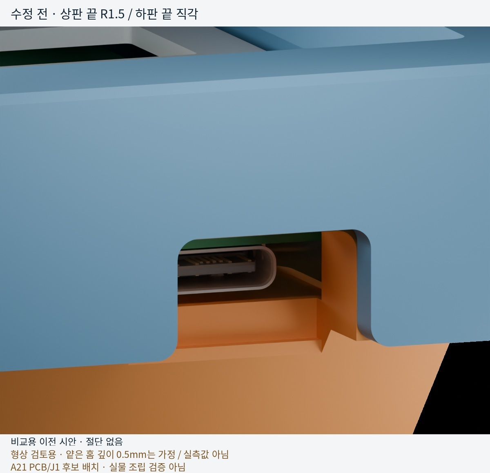
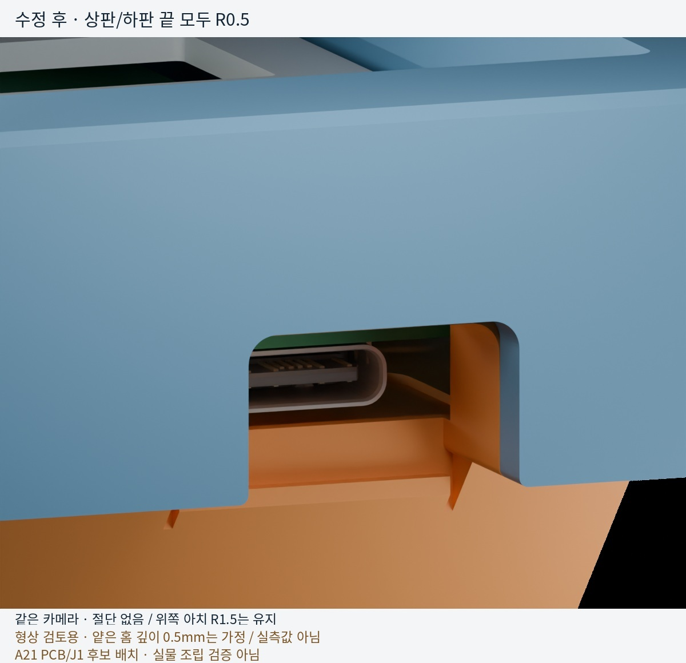
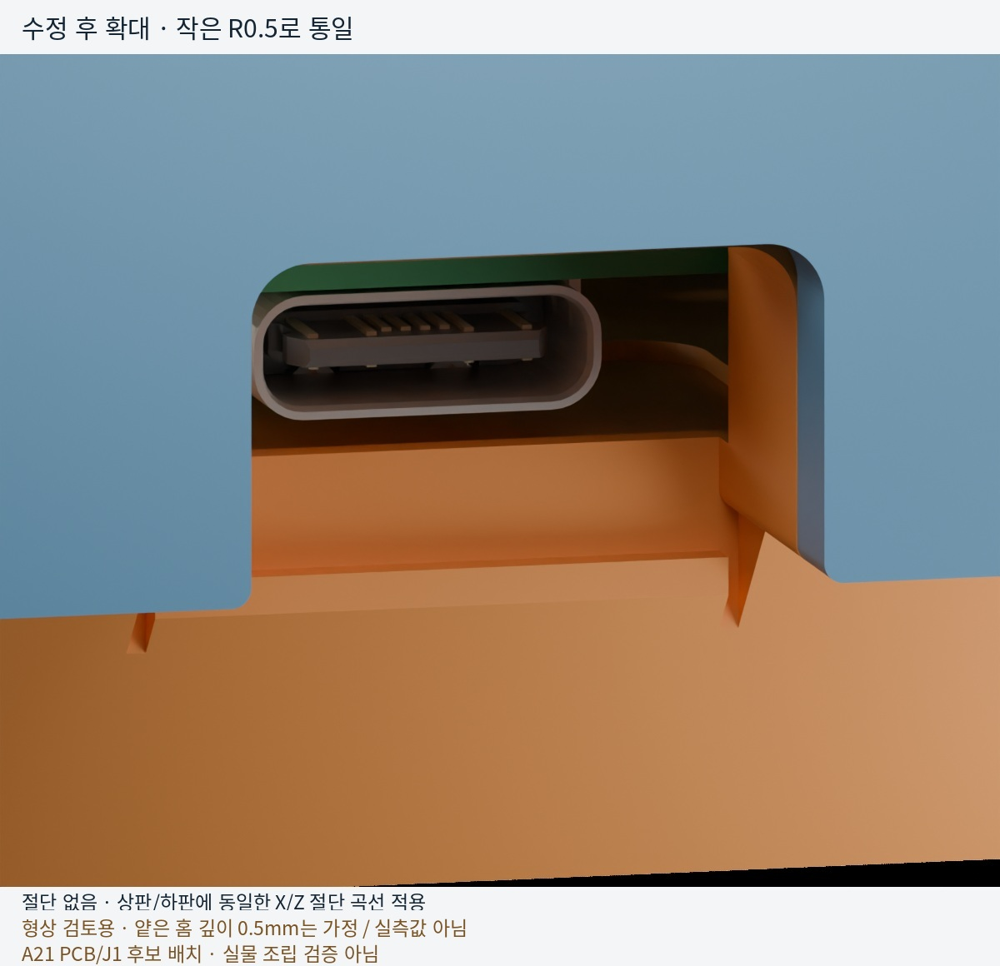
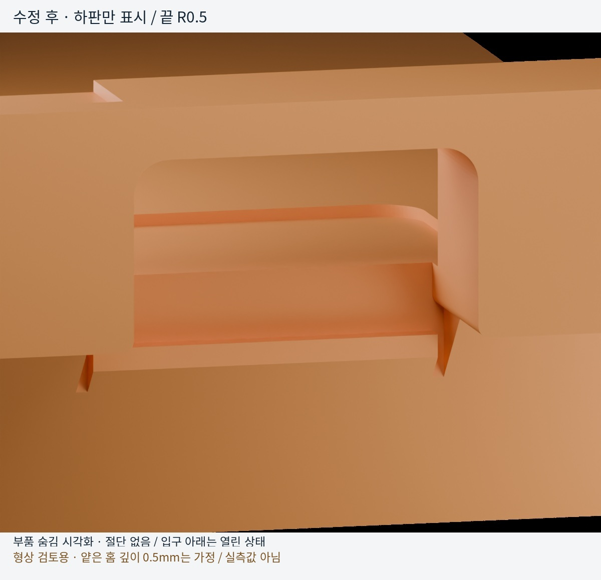

# USB connector: shallow local pocket and matched R0.5 lip rounds

Follow-up to housing PR #1 at `b1cf07038061dd97fe7e448679078e8362da8368`
(top v7.11 / bottom v0.11), default **6095-trimode**, not universal.

The owner's photographs supersede the earlier deep, continuous inner channel.
The inner pocket is now **shallow and bounded**, with a raised end before the
separate outer exit recess. Its dimensions are preview assumptions, not photo
measurements. The lower roof remains flush with the surrounding rim and needs
print support. Its upper opening corners match the top-case R1.5 arch.

The lower free ends of the top-case USB notch were initially rounded too much
(R1.5), while the corresponding bottom-case corners remained square. Both now
use the same **R0.5 X/Z contour**, continued into the open exit rather than cut
as a shallow groove. No bottom bar is added across the passage.

## Current geometry

All dimensions are mm. Zp increases downward; these are **design choices, not
measurements of the photographed stock part**.

| Feature | Geometry |
| --- | --- |
| USB slot | Xworld 124.4975; straight width 14.75; connector position unchanged |
| Lower-case roof | Top flush at Zp 9.69; bottom 11.90; thickness **2.21**; Yworld 187.236–194.370 |
| Bridge attachment | 14.75 clear span, 0.8 overlap into each side support; earlier 6 mm sidewall relief removed |
| Above lower roof | **No separate gap** to the upper case's local inner ceiling at Zp 9.69; cap recesses and fin relief retained |
| Opening corners | Upper arches R1.5; free lip ends R0.5 on both cases, sharing one contour |
| Outer passage | Open below the rounded roof, from Yworld 187.236 through rear face 194.370 and through underside |
| Inner pocket | 20 × 13, R2; Xworld 114.4975–134.4975; Yworld 172.236–185.236; depth 0.50, floor Zp 18.70 |
| Raised end | 1.0 fore-aft before the outer recess; ordinary floor Zp 18.20 |
| Outer recessed floor | Yworld 186.236–187.236, Zp 21.08; the existing **2.88 high vertical step is retained** |
| Generic cable gauge | Rectangular 12.35 × 6.5; clears seated and 0.8 down, with 1.30 floor clearance down |

The owner authorized shipping this state without another floor change. The
2.88 high step is a result of the trial floor levels, **not a proven structural
requirement or a cable-support feature**. Any later smoothing must preserve
floor thickness and recheck connector/cable travel. The gasket recesses and
catch features are unchanged; the current full verifier records gasket bearing.
Both cases' downloads/reports are refreshed. The rectangular cable gauge is
**not a standardized overmold maximum**.

## Verification and printing

The exported STL is probed with a 0.02 inset to avoid float32 boundary noise.
Flush roof presence, the passage **below** it, floor recess depth and retained
floor thickness are checked separately. A solid-looking render alone is not
proof of any of these contracts.

| Check | Current result |
| --- | ---: |
| Pocket blockage / missing shallow floor / missing raised end | 0 / 0 / 0 mm³ |
| Missing flush-roof material / blocked open passage | 0 / 0 mm³ |
| Matched R0.5 lip corners | Both sides pass in both exported cases |
| Paired exported-contour probes against an analytic R0.5 circle | 50 pairs pass |
| Down-facing USB roof in desk-down print pose | 107.01 mm² |
| Full default top / bottom verifiers | ALL_PASSED / ALL_PASSED |

The full default top verifier also passes. See [geometry-checks.json](geometry-checks.json)
and the refreshed [bottom verification](../bottomcase-verification.json).
Single-shell/watertightness, bed size, top/bottom seating, gasket contact,
generic PCB/USB/cable gauges and 0.8 mm downward travel remain checked.
Only the default 6095-trimode profile is qualified by these full runs. The native
A21 J1 bounding envelope clears nominally (0 mm³), but overlaps the retained
end region by **0.0471 mm³ at 0.8 mm down**. The earlier deep-channel claim of
zero native overlap no longer applies. The candidate is **not qualified** for
that full travel; generic-gauge success does not override this result. This is
not USB mating compliance, full manufacturing tolerance analysis or commercial
cable qualification. No final PCB/connector selection is made here.

**Print the USB roof with support.** It spans 14.75 mm and its underside is
approximately 6° above the bed in the intended desk-face-down print pose,
not a self-supporting 45° ramp. The printability verifier explicitly declares
this USB region as supported and records its downward-facing area. A passing
result therefore does **not** mean support-free printing. The 3MF contains
geometry, not generated support toolpaths: enable support in the slicer below
the USB bridge and verify access for removal through the port/open underside.
No slicer toolpath, bridge-sag, support-removal or physical strength test has
been performed; support density/interface gaps remain printer-specific.

The existing full bottom verifier does not support aggregate profile
`universal` (it looks it up as a concrete PCB and raises `StopIteration`).
This pre-existing limitation is unchanged; no universal bottom is published.

## Blender assembly renders

Blender 5.2.2 LTS, Cycles, 24 samples/denoising. Actual CAD meshes, not AI
illustrations. Blue upper case, orange lower case, green PCB, silver USB-C,
gray PC plate. All four views below are **uncut**. The first is explicitly the
historical R1.5-top/square-bottom preview; the next three show current geometry.
The last hides other parts without subtracting material. No exploded offsets,
exaggerated thickness or print supports are added. Older numbered JPGs retained
in this folder are superseded and must not be used as the current shape.

## Inputs and limits

- Housing: PR #1 baseline above plus shallow pocket, flush roof and matched lip-round corrections; 6095-trimode.
- PCB: PR #2 archived [A21 at f87140b](https://github.com/minpeter/maru60/blob/f87140b05bc66ce0eab382aff62b12cf459443ce/pcb/checkpoints/a21/maru60.kicad_pcb),
  native 285 × 94.6 R2 Edge.Cuts and **351 through drills**, 1.6 thick.
  Nominal Zp 12.50–14.10. This WIP PCB is referenced, not adopted or modified.
  Copper pads, solder fillets, other populated electronics, sockets, switches,
  gaskets and cable/overmold are omitted; mask color is illustrative.
- J1: native KiCad (18.0, 3.8), B.Cu, zero footprint/model rotation;
  **USB4105-GF-A candidate**, not a final selection. Official KiCad
  [9.0.2 VRML model](https://gitlab.com/kicad/libraries/kicad-packages3D/-/blob/9.0.2/Connector_USB.3dshapes/USB_C_Receptacle_GCT_USB4105-xx-A_16P_TopMnt_Horizontal.wrl),
  legacy units multiplied by 2.54, native bottom-side pose. [GCT drawing](https://gct.co/files/drawings/usb4105.pdf):
  body width 8.94, body height 3.31 from mounting face. Not the generic verifier box.
- Plate: native INKC HHKB outline and switch/stabilizer cutouts, PC 1.5 at Zp 7.50.
- Frames: Xplate = XGH60 + 0.4525; Yplate = 101.06775 − YGH60.
  Render X = 124.4975 − Xworld; Y = Yworld − 194.37; Z = 20.01 − Zp.
  Proper rigid rotations, not mirroring or moving parts to fake clearance.

Input hashes/camera poses: [provenance.json](provenance.json), [views.json](views.json).
KiCad model attribution: library contributors, CC BY-SA 4.0 with
[KiCad library exception](https://gitlab.com/kicad/libraries/kicad-packages3D/-/blob/9.0.2/LICENSE.md).
The housing's [existing license](../../LICENSE-topcase) is unchanged.

The render is a nominal assembly, not full A21/USB qualification, USB electrical
validation, guaranteed cable reach, printed dimensional accuracy or a stock-part
replica. The existing verifiers use generic component/plug gauges; their passing
results must not be read as a qualification of all commercial cables.
