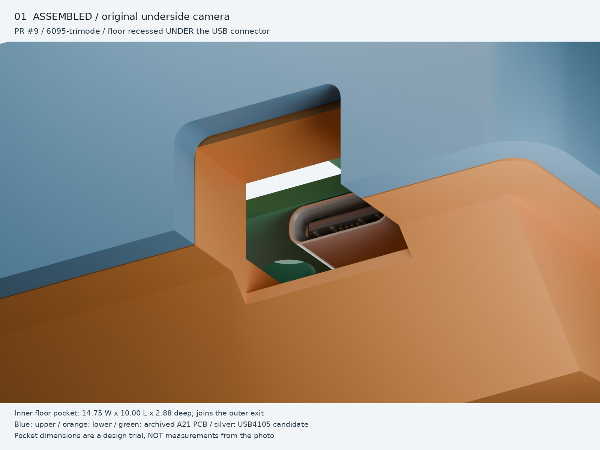
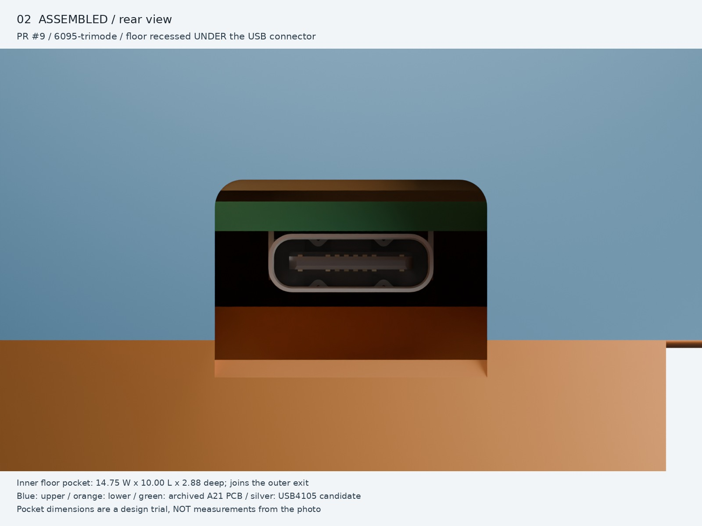
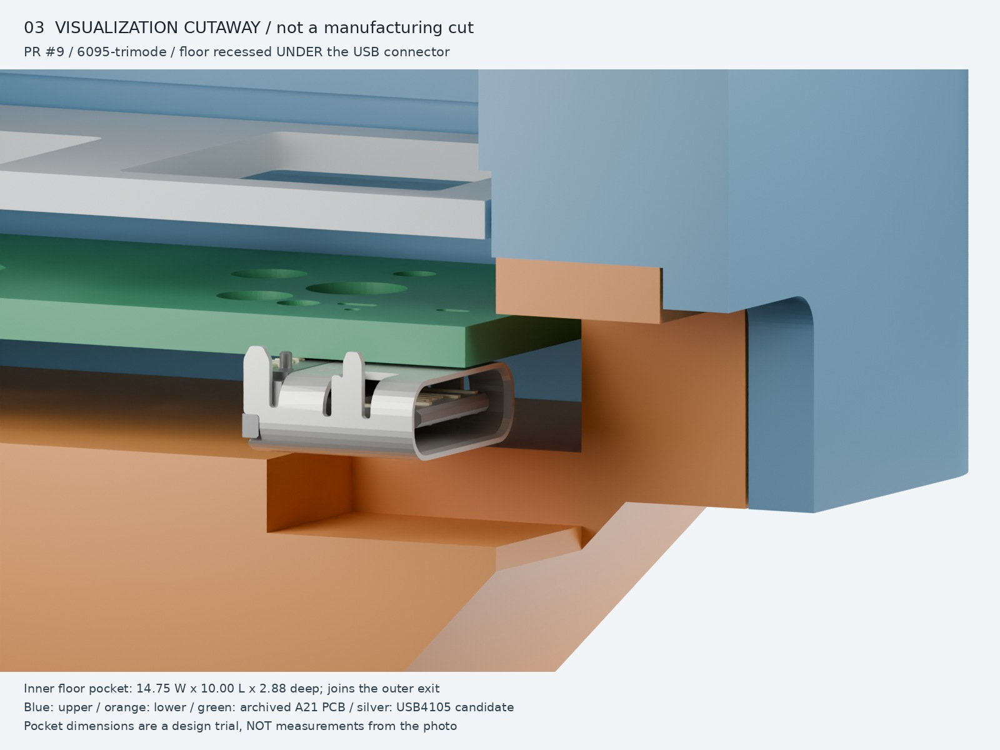
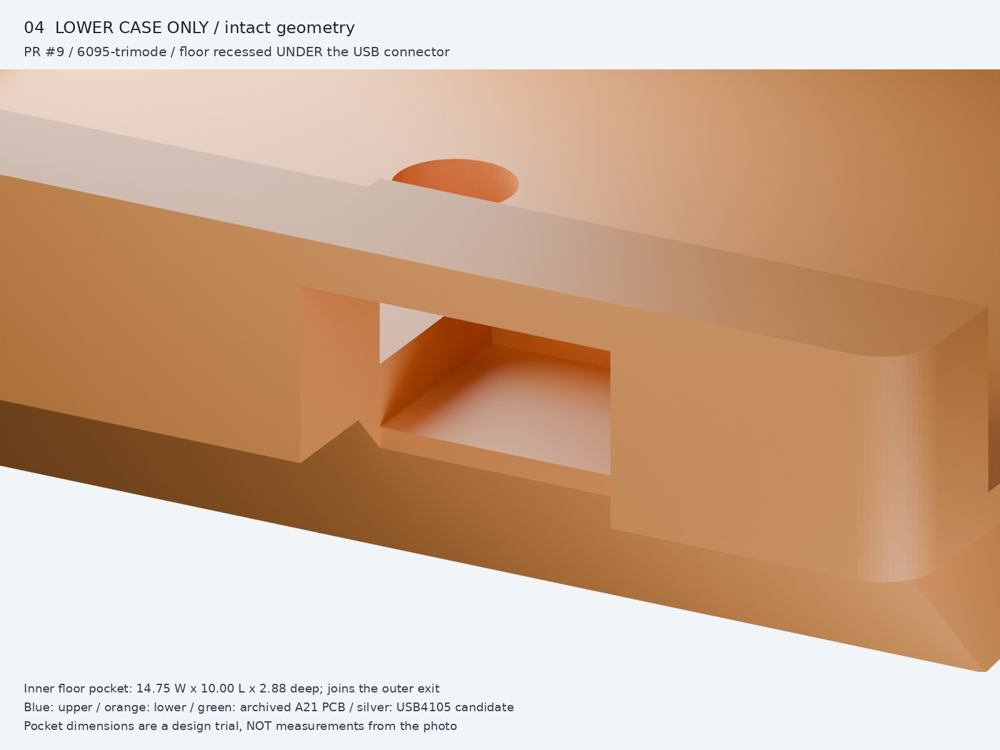
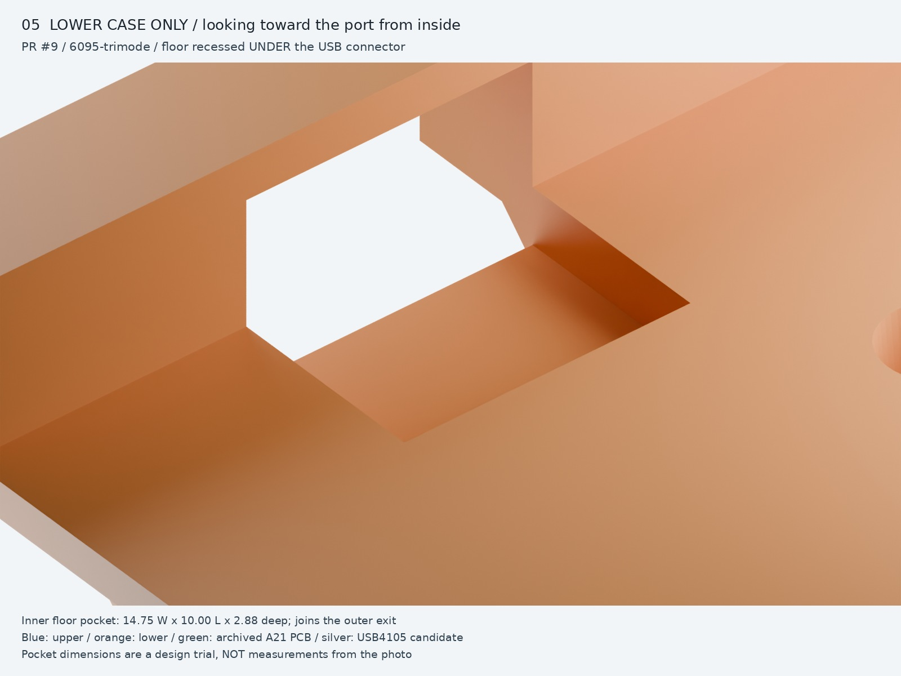

# USB connector: recessed inner floor connected to the exit

Follow-up to housing PR #1 at `b1cf07038061dd97fe7e448679078e8362da8368`
(top v7.11 / bottom v0.11), default **6095-trimode**, not universal.

The owner's latest inside photographs supersede the previous interpretation:
**the lower roof is flush with the surrounding rim, not an independently lowered
beam; the mating floor below the USB opening is recessed more deeply.** Both
upper and lower cases still bridge the passage, and the lower roof needs print
support. The earlier 1.01 mm gap above a separate 1.20 mm beam was an incorrect
interpretation. The floor depth below is a design trial, not photo metrology.

The latest annotated cutaway identifies the **floor directly under the USB
connector inside the housing**, not just the cable exit. The previous revision
left this inner floor at Zp 18.20. This revision removes it across the slot width
and continues the recessed floor 9.0 mm farther inward to sit beneath the whole
candidate receptacle body. The existing roof and outer opening are unchanged.

## Current geometry

All dimensions are mm. Zp increases downward; these are **design choices, not
measurements of the photographed stock part**.

| Feature | Geometry |
| --- | --- |
| USB slot | Xworld 124.4975; width 14.75; top case and connector position unchanged |
| Lower-case roof | Top flush at Zp 9.69; bottom 11.90; thickness **2.21**; Yworld 187.236–194.370 |
| Bridge attachment | 14.75 clear span, 0.8 overlap into each side support; earlier 6 mm sidewall relief removed |
| Above lower roof | **No separate gap** to the upper case's local inner ceiling at Zp 9.69; cap recesses and fin relief retained; rear rounded notch unchanged |
| Below lower bridge | **0.58 roof clearance** to the existing nominal generic plug gauge; downward PCB travel increases it |
| Outer passage | Open below Zp 11.90, from Yworld 187.236 through rear face 194.370 and through underside |
| Recessed inner connector floor | Width 14.75; Yworld **177.236–187.236**, fore-aft length **10.0**; top Zp 21.08, **2.88 below** the ordinary cavity floor at 18.20; minimum vertical skin 0.954279 |
| Generic cable gauge | Rectangular 12.35 × 6.5; clears seated and 0.8 down, with 1.30 floor clearance down |

The outermost 1.0 mm of the recessed floor remains over the sloping underside;
its additional 9.0 mm extends inward over thicker base material. The depth and
reach are trial dimensions, not a claimed USB plug standard or stock measurement.

The bridge attaches to the restored sidewalls as one connected solid. The
gasket recesses, bearing heights/contact areas, catch features and top case
are unchanged from the original housing baseline. Only the published
bottom-left 3MF changes; the other three bottom downloads retain their bytes.
The rectangular cable gauge is **not a standardized overmold maximum**.

## Verification and printing

The exported STL is probed with a 0.02 inset to avoid float32 boundary noise.
Flush roof presence, the passage **below** it, floor recess depth and retained
floor thickness are checked separately. A solid-looking render alone is not
proof of any of these contracts.

| Check | Previous outer-exit-only recess | Current inner-connector recess |
| --- | ---: | ---: |
| Material filling the inner connector recess probe | **374.3165 mm³** | **0 mm³** |
| Missing flush-roof material | 0 mm³ | 0 mm³ |
| Material blocking passage below bridge | 0 mm³ | 0 mm³ |
| Down-facing USB roof in desk-down print pose | 105.23 mm² | **105.23 mm²** |
| Default full bottom verifier | New inner-recess test fails | ALL_PASSED |

The full default top verifier also passes. See [geometry-checks.json](geometry-checks.json)
and the refreshed [bottom verification](../bottomcase-verification.json).
Single-shell/watertightness, bed size, top/bottom seating, gasket contact,
generic PCB/USB/cable gauges and 0.8 mm downward travel remain checked.
Focused CSG checks cover 6095-trimode, ph60-rev3 and universal; they are not
full alternate-profile builds. The change only removes material inside the
specified floor pocket; it adds no material, so the prior native PCB clearance
cannot decrease. The native A21 J1 bounding envelope now clears at nominal
height and **0.8 mm down** (both 0 mm³ overlap). The prior 0.010 mm floor incursion
at 0.8 mm down is removed by this inner recess. This is an envelope clearance
check, not USB mating compliance, full manufacturing tolerance analysis or a
qualification of all commercial male plugs.

**Print the USB roof with support.** It spans 14.75 mm and its underside is
approximately 6° above the bed in the intended desk-face-down print pose,
not a self-supporting 45° ramp. The printability verifier explicitly declares
this USB region as supported and records its downward-facing area. A passing
result therefore does **not** mean support-free printing. The 3MF contains
geometry, not generated support toolpaths: enable support in the slicer below
the USB bridge and verify access for removal through the port/open underside.
No slicer toolpath, bridge-sag, support-removal or physical strength test has
been performed; support density/interface gaps remain printer-specific.

The existing full bottom verifier does not support aggregate profile
`universal` (it looks it up as a concrete PCB and raises `StopIteration`).
This pre-existing limitation is unchanged; no universal bottom is published.

## Blender assembly renders

Blender 5.2.2 LTS, Cycles, 32 samples/denoising. Actual CAD meshes, not AI
illustrations. Blue upper case, orange lower case, green PCB, silver USB-C,
gray PC plate. The first camera retains the previous underside-oblique pose.

Views 1/2 are intact nominal assemblies. View 3 cuts the housing, plate and PCB
at render X = +0.08 only to expose the stack; the detailed J1 connector remains
intact. **This is not a manufacturing cut.** Views 4/5 hide the other parts without
subtracting them. No exploded offsets, exaggerated thickness or print supports
are added. The roof's top is coplanar with the surrounding rim, rather than
floating below it. The rounded notch in the upper case is unchanged.

## Inputs and limits

- Housing: PR #1 baseline above plus flush-roof/inner-connector-floor correction; 6095-trimode.
- PCB: PR #2 archived [A21 at f87140b](https://github.com/minpeter/maru60/blob/f87140b05bc66ce0eab382aff62b12cf459443ce/pcb/checkpoints/a21/maru60.kicad_pcb),
  native 285 × 94.6 R2 Edge.Cuts and **351 through drills**, 1.6 thick.
  Nominal Zp 12.50–14.10. This WIP PCB is referenced, not adopted or modified.
  Copper pads, solder fillets, other populated electronics, sockets, switches,
  gaskets and cable/overmold are omitted; mask color is illustrative.
- J1: native KiCad (18.0, 3.8), B.Cu, zero footprint/model rotation;
  **USB4105-GF-A candidate**, not a final selection. Official KiCad
  [9.0.2 VRML model](https://gitlab.com/kicad/libraries/kicad-packages3D/-/blob/9.0.2/Connector_USB.3dshapes/USB_C_Receptacle_GCT_USB4105-xx-A_16P_TopMnt_Horizontal.wrl),
  legacy units multiplied by 2.54, native bottom-side pose. [GCT drawing](https://gct.co/files/drawings/usb4105.pdf):
  body width 8.94, body height 3.31 from mounting face. Not the generic verifier box.
- Plate: native INKC HHKB outline and switch/stabilizer cutouts, PC 1.5 at Zp 7.50.
- Frames: Xplate = XGH60 + 0.4525; Yplate = 101.06775 − YGH60.
  Render X = 124.4975 − Xworld; Y = Yworld − 194.37; Z = 20.01 − Zp.
  Proper rigid rotations, not mirroring or moving parts to fake clearance.

Input hashes/camera poses: [provenance.json](provenance.json), [views.json](views.json).
KiCad model attribution: library contributors, CC BY-SA 4.0 with
[KiCad library exception](https://gitlab.com/kicad/libraries/kicad-packages3D/-/blob/9.0.2/LICENSE.md).
The housing's [existing license](../../LICENSE-topcase) is unchanged.

The render is a nominal assembly, not full A21/USB qualification, USB electrical
validation, guaranteed cable reach, printed dimensional accuracy or a stock-part
replica. The existing verifiers use generic component/plug gauges; their passing
results must not be read as a qualification of all commercial cables.
