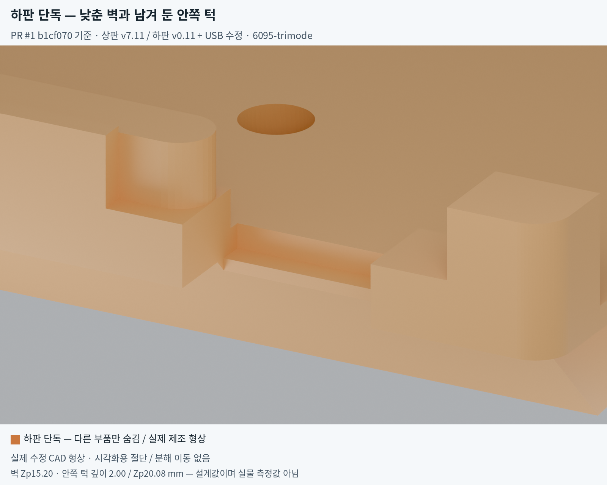

# USB exit: low sidewalls, open outer exit, retained inner ledge

Follow-up to housing PR #1 at `b1cf07038061dd97fe7e448679078e8362da8368`
(top case v7.11 / bottom case v0.11), default `6095-trimode`. The owner corrected
the previous render: the orange bottom case rose to the ceiling beside the USB
entrance. Simply cutting the whole slot through the base did not fix that.
The owner approved lowering those walls while retaining the inner horizontal ledge.

This revision supersedes the first PR #9 correction at `69d8703`. The initial
review's physical "protruding floor" interpretation and the claim that the entire
inner slot must be floorless were not established by the photographs.

| Feature | Current design, Zp positive downward |
| --- | --- |
| Slot | Xworld 124.4975, width 14.75; top case and connector position unchanged |
| Sidewalls | Local relief extends 6.0 mm to each side; top lowered from Zp 9.69 to 15.20, excluding actual rounded gasket-bearing outlines plus a 0.10 mm margin |
| Clearance to PCB underside | 1.10 mm nominal; 0.30 mm after 0.80 mm downward travel |
| Inner ledge | Yworld 186.236–188.236, 2.0 mm deep, top at Zp 20.08; minimum vertical thickness 0.917741 mm over the sloping base |
| Open outer exit | From Yworld 188.236 through the rear face at 194.37; cutter continues to 195.37 and through the underside |
| Cable-body gauge | Existing rectangular 12.35 × 6.5 mm gauge, not a standardized overmold maximum; 0.30 mm ledge clearance after 0.80 mm downward travel |

These heights, relief width and ledge depth are **design choices, not measured
dimensions of the photographed stock part**. A ledge at the ordinary Zp 18.20
cavity floor collided with the existing cable-body gauge; retaining a short,
lower ledge over the thicker base permits the gauge's downward travel without
leaving a sub-0.8 mm skin. A narrow side relief still exposed a high wall in the
oblique render. The final relief is 6 mm per side and preserves the rounded
gasket contact areas, not the unused corners of the oversized rectangular
recess floors: those corners also formed a wall up to the entrance ceiling.
The rounded bearing outlines have a 0.10 mm support margin. This is not a
guarantee for arbitrary retail cables.
Only the published bottom-left half changes; the other three bottom downloads,
the top case and catch features are unchanged. Gasket bearing heights and full
contact areas are preserved; unused recess-floor material near USB is relieved.

## Regression evidence

The verifier probes the exported STL assembly, inset 0.02 mm to avoid float32
boundary noise. Checks require an open outer exit, retained inner ledge of at
least 0.8 mm thickness, and low shoulders with material remaining below them.
The generic cable-body gauge must clear both cases seated and 0.8 mm down.

| Check | First PR #9 correction (`69d8703`) | Current correction |
| --- | ---: | ---: |
| Material in the two high-shoulder probes | 57.3156 mm³ | 0.0000 mm³ |
| Missing material in the retained-ledge probe | 23.0653 mm³ | 0.0000 mm³ |
| Material bridging the outer exit | 0.0000 mm³ | 0.0000 mm³ |
| Gasket-bearing material lost to this revision | — | 0.0000 mm³ |
| Geometry changed outside the local USB region | — | 0.0000 mm³ |
| Default-board full bottom-case verifier | New shoulder/ledge regression fails | `ALL_PASSED` |

Direct before/after solid checks for `6095-trimode`, `ph60-rev3` and `universal`
are recorded in [geometry-checks.json](geometry-checks.json). The default full
top-case verifier also passes. The earlier 66.327 mm³ full-slot probe was too
broad: it counted inner base material as well as the rear residual skin, and
is deliberately replaced by separate outer-exit and retained-ledge probes.
The existing full bottom-case verifier **does not support `universal`**: it
looks up that aggregate profile as an actual PCB ID and raises `StopIteration`
in `usb_centre_plate_x`. This pre-existing limitation is not hidden or changed
by this fix. No universal bottom half is published here.

## Assembly renders

Blender 5.2.2 LTS, Cycles, 32 samples with denoising. These are actual CAD mesh
renders, not generated illustrations. The first camera reproduces the previous
third image's underside-oblique position and 45 mm orthographic width.

Blue: top case; orange: corrected bottom case; green: PCB; silver: USB shell;
light gray: PC plate. The first two views have no visual cuts, exploded offsets,
transparency or exaggerated thickness. The third removes the camera-side half
at render X = +0.08 mm solely to reveal the internal stack; **this cutaway is
not an additional manufacturing cut**. The fourth shows the intact bottom case
alone; the other parts are hidden, not subtracted from the manufacturing model.

The first view explicitly labels the **remaining high rounded gasket support**
and the lowered entry sidewall separately. That support is deliberately not
removed: the current nominal cap stack requires bearing at Zp 10.20, above
the PCB. Lowering it to Zp 15.20 would remove the cap's specified support.
The photographs do not independently verify that nominal support geometry;
this revision must not be described as removing every high orange surface
or as an exact reproduction of the photographed stock case.

### PCB and connector provenance

- Housing: default `6095-trimode` USB profile, **not universal**; corrected
  bottom case generated from this PR. The top case is unchanged from PR #1.
- PCB: PR #2 commit `f87140b05bc66ce0eab382aff62b12cf459443ce`, native
  [`pcb/checkpoints/a21/maru60.kicad_pcb`](https://github.com/minpeter/maru60/blob/f87140b05bc66ce0eab382aff62b12cf459443ce/pcb/checkpoints/a21/maru60.kicad_pcb).
  The 285 × 94.6 mm R2 Edge.Cuts, 1.6 mm substrate, through drills and nearby
  B.Cu pads are represented. Solder-mask color is illustrative; other populated
  components, solder fillets, switches, sockets and gaskets are not rendered.
  The archived A21 PCB is WIP, not fabrication-ready, and is **not adopted or
  modified by this PR**.
- J1: the native A21 footprint at KiCad (18.0, 3.8) mm on B.Cu, zero rotation:
  `USB_C_Receptacle_GCT_USB4105-xx-A_16P_TopMnt_Horizontal`.
  Its value is explicitly **USB4105-GF-A (candidate)**, not a final selection.
- Connector geometry: official KiCad **9.0.2** library
  [USB4105 VRML model](https://gitlab.com/kicad/libraries/kicad-packages3D/-/blob/9.0.2/Connector_USB.3dshapes/USB_C_Receptacle_GCT_USB4105-xx-A_16P_TopMnt_Horizontal.wrl),
  converted from legacy 2.54 mm units and placed using the native B.Cu pose.
  [GCT drawing](https://gct.co/files/drawings/usb4105.pdf): 8.94 mm body width,
  3.31 mm body height above its PCB mounting face. The rendered shell is not
  the old generic 9.0 × 7.4 × 3.26 mm verification box.
- Plate: native INKC HHKB outline and cutouts, 1.5 mm PC, top at Zp 7.50.
  PCB top/bottom: Zp 12.50 / 14.10, using the housing's nominal MX stack.
- Frames: Xplate = XGH60 + 0.4525; Yplate = 101.06775 − YGH60. Render frame:
  X = 124.4975 − Xworld; Y = Yworld − 194.37; Z = 20.01 − Zp. This is a rigid
  rotation, not a mirror. No component was moved to make it appear to fit.

Exact input hashes and camera poses are in [provenance.json](provenance.json)
and [views.json](views.json). KiCad library model attribution: KiCad library
contributors, CC BY-SA 4.0 with the KiCad library exception; see the
[library license](https://gitlab.com/kicad/libraries/kicad-packages3D/-/blob/9.0.2/LICENSE.md).
The exception covers generated design files; this visualization does not
change the housing's [existing license](../../LICENSE-topcase) or select a PCB
hardware license.

### Validation boundary

The render shows a nominal assembly pose, not complete PCB-to-case clearance
certification, solder-joint strength, USB mating compliance, cable reach or
physical gasket-travel validation. No cable or overmold is rendered.
The existing verifier still uses its documented generic PCB/component/plug
gauges; its passing results must not be read as a full A21/USB4105 qualification.
The 0.84 mm generic-body floor clearance is not a measured USB4105 clearance.
