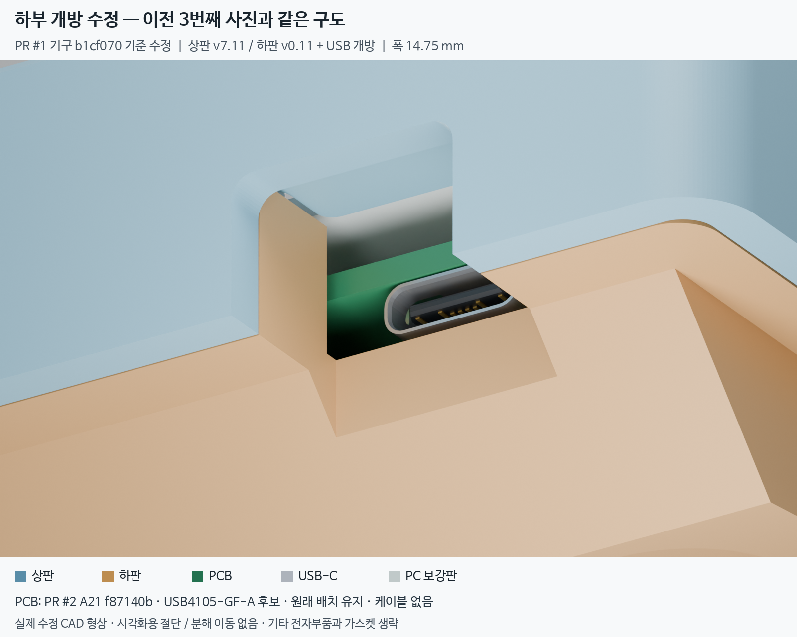
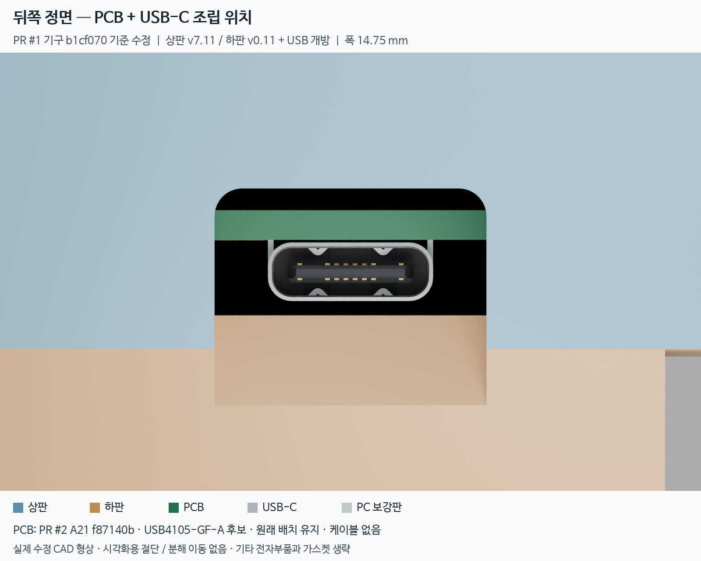
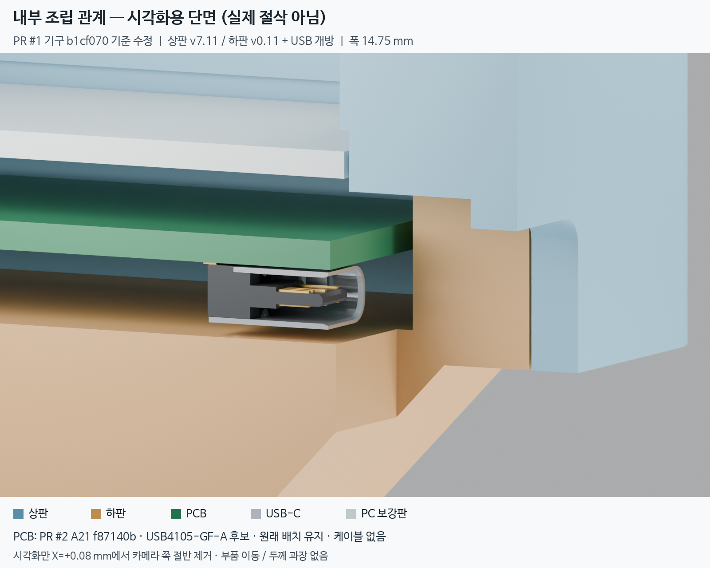

# USB exit: open underneath

Follow-up to housing PR #1 at `b1cf07038061dd97fe7e448679078e8362da8368`
(top case v7.11 / bottom case v0.11). The owner confirmed that the USB exit
is open underneath: the old review's annotation of a physical protruding
ledge/floor was incorrect.

The old cutter stopped at the top-case skirt lip, Zp 20.01. The tray underside
is tilted and the base extends farther down. The correction cuts the existing
slot plan through both solids, without changing its centre, 14.75 mm width,
length, surrounding steps, gasket seats or top case. Only the published
bottom-left half changes; the other three bottom-case downloads retain their
original bytes. This is a CAD correction to match the owner's intended open
exit, not evidence that the physical case had a fragile floor.

## Regression evidence

The new check probes the exported STL assembly from above the rail to below
the deepest underside, inset 0.02 mm from the slot edges to avoid float32
boundary noise. It is independent of the cutter's reported depth.

| Check | Before | After |
| --- | ---: | ---: |
| Material inside the open-bottom probe | 66.327 mm³ — assertion fails | 0.0000 mm³ — passes |
| Bottom-left model volume | 111348.568 mm³ | 111281.159 mm³ |
| Default-board full bottom-case verifier | New open-bottom regression fails | `ALL_PASSED` |

The volume difference includes the inner base inside the slot plan, not only
the 0–0.02 mm CAD residual face at the rear step. Do not describe 66.327 mm³
as the volume of that thin face.

Both top-case verification runs (default and universal) pass. Direct solid
checks of `6095-trimode`, `ph60-rev3` and `universal` confirm an open bottom.
The existing full bottom-case verifier **does not support `universal`**: it
looks up that aggregate profile as an actual PCB ID and raises `StopIteration`
in `usb_centre_plate_x`. This pre-existing limitation is not hidden or changed
by this fix. No universal bottom half is published here.

## Assembly renders

Blender 5.2.2 LTS, Cycles, 32 samples with denoising. These are actual CAD mesh
renders, not generated illustrations. The first camera reproduces the previous
third image's underside-oblique position and 45 mm orthographic width.

Blue: top case; ochre: corrected bottom case; green: PCB; silver: USB shell;
light gray: PC plate. The first two views have no visual cuts, exploded offsets,
transparency or exaggerated thickness. The third removes the camera-side half
at render X = +0.08 mm solely to reveal the internal stack; **this cutaway is
not an additional manufacturing cut**.

### PCB and connector provenance

- Housing: default `6095-trimode` USB profile, **not universal**; corrected
  bottom case generated from this PR. The top case is unchanged from PR #1.
- PCB: PR #2 commit `f87140b05bc66ce0eab382aff62b12cf459443ce`, native
  [`pcb/checkpoints/a21/maru60.kicad_pcb`](https://github.com/minpeter/maru60/blob/f87140b05bc66ce0eab382aff62b12cf459443ce/pcb/checkpoints/a21/maru60.kicad_pcb).
  The 285 × 94.6 mm R2 Edge.Cuts, 1.6 mm substrate, through drills and nearby
  B.Cu pads are represented. Solder-mask color is illustrative; other populated
  components, solder fillets, switches, sockets and gaskets are not rendered.
  The archived A21 PCB is WIP, not fabrication-ready, and is **not adopted or
  modified by this PR**.
- J1: the native A21 footprint at KiCad (18.0, 3.8) mm on B.Cu, zero rotation:
  `USB_C_Receptacle_GCT_USB4105-xx-A_16P_TopMnt_Horizontal`.
  Its value is explicitly **USB4105-GF-A (candidate)**, not a final selection.
- Connector geometry: official KiCad **9.0.2** library
  [USB4105 VRML model](https://gitlab.com/kicad/libraries/kicad-packages3D/-/blob/9.0.2/Connector_USB.3dshapes/USB_C_Receptacle_GCT_USB4105-xx-A_16P_TopMnt_Horizontal.wrl),
  converted from legacy 2.54 mm units and placed using the native B.Cu pose.
  [GCT drawing](https://gct.co/files/drawings/usb4105.pdf): 8.94 mm body width,
  3.31 mm body height above its PCB mounting face. The rendered shell is not
  the old generic 9.0 × 7.4 × 3.26 mm verification box.
- Plate: native INKC HHKB outline and cutouts, 1.5 mm PC, top at Zp 7.50.
  PCB top/bottom: Zp 12.50 / 14.10, using the housing's nominal MX stack.
- Frames: Xplate = XGH60 + 0.4525; Yplate = 101.06775 − YGH60. Render frame:
  X = 124.4975 − Xworld; Y = Yworld − 194.37; Z = 20.01 − Zp. This is a rigid
  rotation, not a mirror. No component was moved to make it appear to fit.

Exact input hashes and camera poses are in [provenance.json](provenance.json)
and [views.json](views.json). KiCad library model attribution: KiCad library
contributors, CC BY-SA 4.0 with the KiCad library exception; see the
[library license](https://gitlab.com/kicad/libraries/kicad-packages3D/-/blob/9.0.2/LICENSE.md).
The exception covers generated design files; this visualization does not
change the housing's [existing license](../../LICENSE-topcase) or select a PCB
hardware license.

### Validation boundary

The render shows a nominal assembly pose, not complete PCB-to-case clearance
certification, solder-joint strength, USB mating compliance, cable reach or
physical gasket-travel validation. No cable or overmold is shown or assumed.
The existing verifier still uses its documented generic PCB/component/plug
gauges; its passing results must not be read as a full A21/USB4105 qualification.
The 0.84 mm generic-body floor clearance is not a measured USB4105 clearance.
