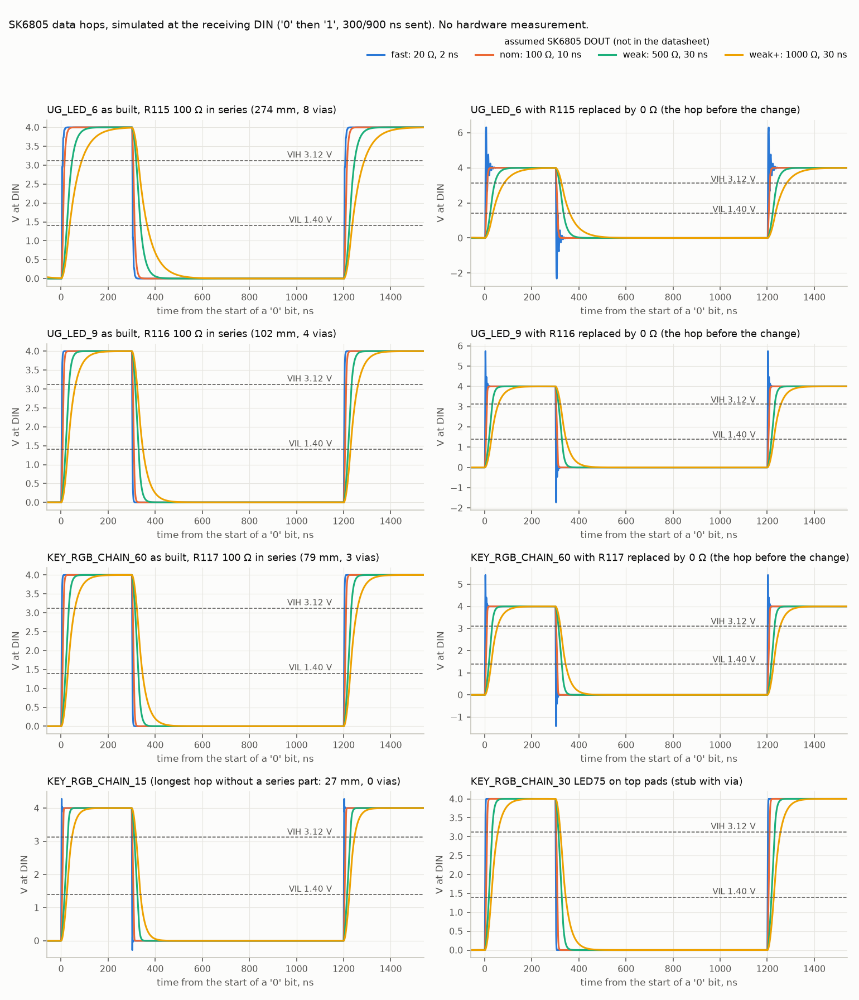
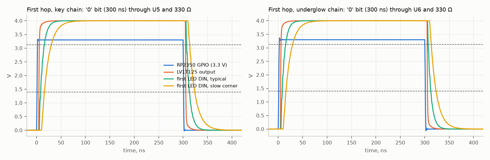
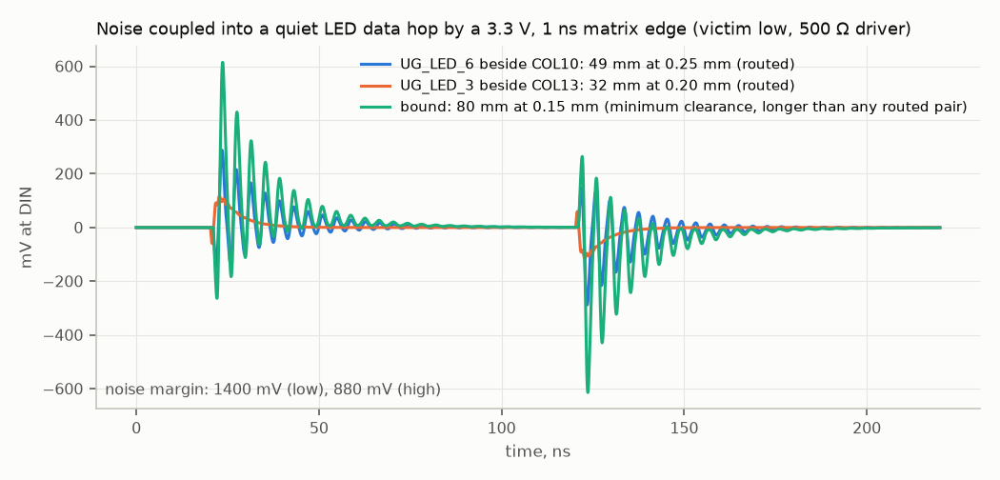
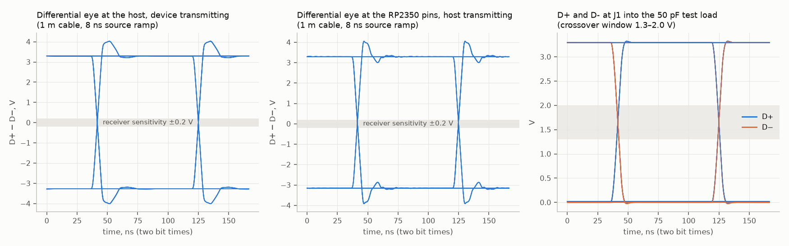
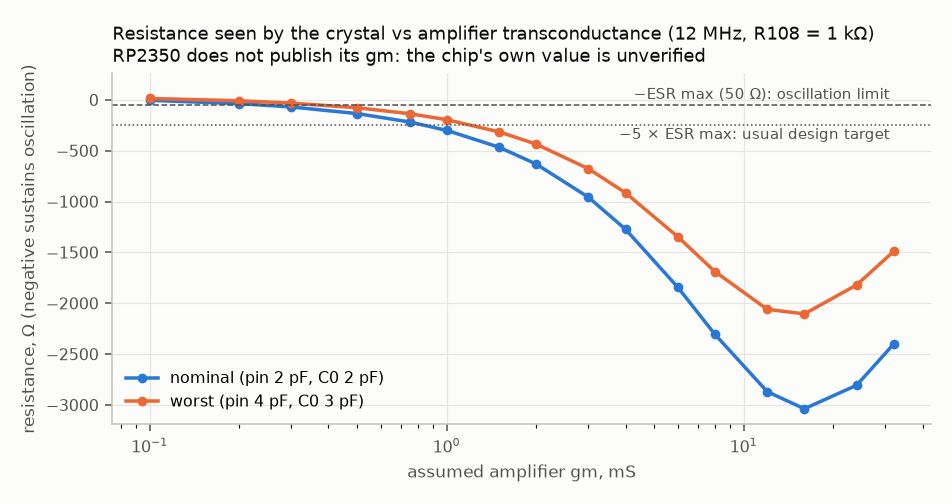
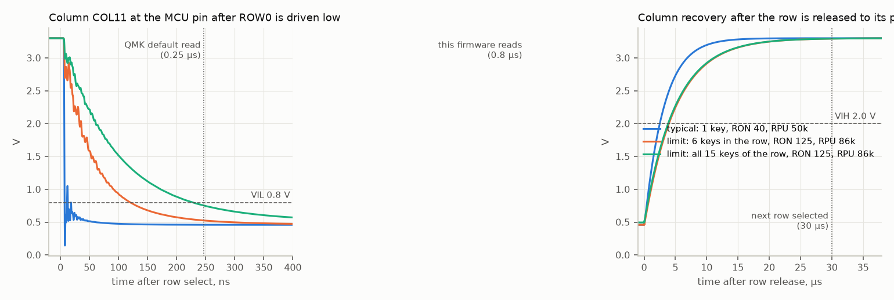

# Signal integrity

Board `pcb/maru60.kicad_pcb`, SHA-256 `8057453f7587…` (`results.json` carries the
full hash; `run_all.py --check` compares it with the board file). Everything is
computed or simulated from the routed copper with the tools in
[`pcb/tools/signal_integrity`](../../../../tools/signal_integrity/README.md): a 2-D
field solve of the outer-layer cross-section (−0.5 … +1.2 % against
Hammerstad–Jensen), lossy LC-ladder lines, ngspice 39. **No hardware exists;
nothing here is a measurement.**

Basis words used below: **simulated** (ngspice on the routed geometry),
**computed** (field solve or hand calculation), **datasheet** (a limit read from
the named document), **assumed** (the document does not give the value; the
value used is stated and swept).

## Verdict

| Signal | Result | Margin | Basis |
| --- | --- | --- | --- |
| LED data, first hops: GPIO → U5/U6 → 330 Ω → LED1 (137 mm, 7 vias) / LED63 (116 mm, 8 vias) | pass. Rise/fall 14–28 ns, no overshoot, no ring-back | noise margin 0.88 V high, 1.40 V low; pulse-width error −16.4 / +7.7 ns against ±100 ns | simulated; buffer output 15–100 Ω and its tPLH/tPHL difference assumed |
| LED data, the 51 LED-to-LED hops without a series part (all key hops, no vias: 15–27 mm, median 21 mm) | pass for every output swept (10–100 Ω, 1–10 ns) | the longest (`KEY_RGB_CHAIN_15`, 26.6 mm) keeps 0.08 V with a 10 Ω / 1 ns output, 0.57 V with 20 Ω / 1 ns, 0.76 V with 20 Ω / 2 ns and the full margin with 100 Ω / 10 ns; pulse-width error at most −29 / +13 ns with a 1 kΩ output | simulated; SK6805 output strength assumed; finding 3 |
| LED data, the 23 hops with 100 Ω at their source (`R115`–`R119`, `R170`–`R186`, `R188`): every underglow hop (28–274 mm) and the key hops that rang back with a 10 Ω / 1 ns output | pass for every output swept: no overshoot, no ring-back | noise margin 0.87–0.88 V / 1.36–1.40 V; pulse-width error at most −60 / +29 ns (274 mm), −39 / +19 ns (the others) | simulated |
| LED data, Caps Lock alternative sites (`KEY_RGB_CHAIN_29/30/31`; `_30` and `_31` behind `R188` and `R186`) | pass in every fitted combination | `_30`, `_31`: 0.88 V with every output; `_29` (22 mm, 9–16 mm stub, no series part): ≥ 0.79 V with 20 Ω / 2 ns | simulated |
| Matrix edges coupling into LED data | ±0.30 V on the worst routed pair (`UG_LED_6` beside `COL10`, 49 mm at 0.25 mm) | 0.88 V available; 0.65 V for a hypothetical 80 mm at 0.15 mm | simulated, 3.3 V / 1 ns aggressor |
| Buck switch node (500 kHz) into LED data and `RUN` | ≤ 1.1 mV into `UG_LED_10` (2.72 mm away), ≤ 1.5 mV into `RUN` (1.72 mm) | > 500 × | computed (field-solve mutual capacitance over the plane) |
| USB FS, device transmitting, 50 pF test load at J1 | VCRS 1.647–1.655 V; TFR = TFF; jitter ±0.05 ns | 1.3–2.0 V; 90–111 %; ±3.5 ns | simulated; PHY edge rate assumed |
| USB FS eye at the host after 1 m of cable | 3.27 V high at the centre, 0.995–0.997 UI wide above ±0.2 V | sensitivity 0.2 V | simulated |
| USB FS eye at the RP2350, host transmitting | 3.15 V, 0.988–0.997 UI, VCRS 1.67–1.69 V, jitter ±0.30 ns | receiver tolerates ±18.5 ns | simulated |
| USB pair geometry | 95 Ω differential / 34 Ω common for 123 mm; D+ 1.5 mm longer than D− (11 ps); ground plane under the whole pair | full speed sets no board impedance or skew limit | computed |
| USB delay, J1 to the RP2350 | 0.915 ns to R102/R103, 0.955 ns to the pins (1.03 / 1.07 ns before the pair was laid again) | 1 ns allowed: 4.5 % under; finding 2 | simulated |
| Crystal load capacitance | 8.7–9.3 pF for a 10 pF crystal: +10 … +20 ppm (bracket −5 … +37 ppm) | USB full speed ±2500 ppm; crystal class ±30 ppm | computed; pin capacitance and motional capacitance assumed |
| Crystal start-up and drive level | needs gm ≥ 0.5 mS for −50 Ω, ≥ 1.5 mS for −250 Ω; drive level ≤ 178 µW | 200 µW maximum; **RP2350 gm is not published: UNVERIFIED** | simulated (AC); same circuit as the Raspberry Pi reference |
| QSPI flash | longest net 23.5 mm, data against clock 5.7 mm (34 ps), no vias | 13.8 ns slack at the 25 MHz used; 0.5 ns at 75 MHz (not used) | computed |
| SWD | `SWCLK` 35 mm, `SWDIO` 67 mm (0.4 ns) | 2.5 % of a half period at 30 MHz | computed |
| `RUN` | 87 mm, 14 pF, internal pull-up only; all neighbours switching together couple 47 mV | 2.5 V needed for a reset: 53 × | computed |
| BOOTSEL | button net is behind 1 kΩ (R106); pressed level 0.30 V | VIL 0.8 V | computed |
| Key matrix, column valid after row select | 13 ns typical; 45 ns at the pin limits; 120 ns with six keys of the row held | the firmware waits 800 ns: 63 × / 18 × / 6.7 × | simulated |
| Key matrix, all 15 keys of row 0 held, pin at its data-sheet limits | 228 ns at 27 °C, 250 ns at 0 °C | 3.5 × / 3.2 × with the 800 ns wait (1.1 × / 1.0 × with QMK's 247 ns default, which the firmware used before) | simulated; finding 1, closed |
| Key matrix, column back high after row release | 1.5–4.4 µs | QMK waits 30 µs: ≥ 6.9 × | simulated |
| Key matrix leakage at 60 °C | 0.65 V droop with all 61 other diodes at maximum leakage | 1.3 V allowed: 2.0 × | computed from the 1N4148W data sheet |
| Expansion port, switch off or board unpowered | ≤ 10 µA per line into the port, no path into a supply rail | MCU pin offset ≤ 0.39 V, VIL 0.8 V | datasheet (SN74CB3T3245, TPD6E05U06) |
| Expansion port, 3.3 V and 5 V signals from outside | 2.83–3.02 V and 3.02–3.36 V at the MCU pin | ≥ 0.83 V above VIH; below IOVDD + 0.3 V | datasheet curves, scaled to 3.3 V |

## Changes made and what is left

No finding blocks the order. All three findings of the earlier runs are acted
on.

1. **Matrix read delay: done in the firmware.** QMK's default reads the
   columns 37 CPU cycles (247 ns) after it drives a row. With all 15 keys of
   row 0 held, the row pin at its 125 Ω limit and 86 kΩ pull-ups, the last
   column is below 0.8 V after 228 ns at 27 °C and 250 ns at 0 °C: no margin.
   `keyboards/maru60/rp2350/config.h` now has

   ```c
   #define GPIO_INPUT_PIN_DELAY 120   /* CPU cycles: 0.8 µs at 150 MHz */
   ```

   which gives 3.2 × in that corner and costs 2.8 µs per scan. Both layouts
   were rebuilt; the linked `matrix_output_select_delay` holds 120 `nop`
   instructions ([`qa/qmk-build`](../qmk-build/RESULT.json)). The value must
   stay within 1–135: `wait_cpuclock()` (`platforms/chibios/_wait.c`) runs no
   8-cycle block above that, so 150, for example, waits 6 cycles (40 ns).
   `config.h` rejects a value outside the range at compile time.
2. **USB delay: the pair was laid again.** USB 2.0 §7.1.16 allows 1 ns from
   the connector to the transceiver. The old route (156 mm staircase, four
   vias per line) was 1.03 ns to the 27 Ω parts and 1.07 ns to the pins. The
   new one is 138.5 mm (D+) and 137.0 mm (D−) plus the unchanged 4 mm after
   the resistors, still four vias per line: 0.915 ns and 0.955 ns. In this
   model a via costs about as much delay as 4 mm of track, so the search
   (`plan_pair_route.py`) weighed both. With every other piece of copper left
   in place, the same corridor without the staircase is the shortest; a route
   on the bottom layer alone (no vias before the last hop) is 15 mm longer,
   and crossing other tracks would save 3 mm at most. The margin is 4.5 % in
   a model whose main uncertainty is the prepreg permittivity (4.4 assumed).
3. **LED data: every hop that rang back in the sweep has a series resistor.**
   The data sheet gives no output figure, so the sweep runs from 10 Ω / 1 ns
   to 100 Ω / 10 ns. Without a series part, a 10 Ω / 1 ns output took every
   hop from about 27 mm up through the 3.12 V threshold after the edge
   (−0.04 … −1.0 V), and 20 Ω / 1 ns did the same from about 55 mm. 100 Ω at
   the source removes it: all 23 such hops keep 0.87–0.88 V at every point.
   The 51 hops left are 26.6 mm or shorter and keep at least 0.08 V at
   10 Ω / 1 ns (`strong_driver_screen` in `results.json` lists every hop and
   every fitted combination of the two-site LEDs at the four strongest
   outputs: 81 rows, none negative). Look at one LED input (`LED59`, `LED74`)
   with a scope at bring-up all the same.

## LED data

Thresholds 3.12 V and 1.40 V (0.78 and 0.35 × VDD at the 4.0 V LED rail,
OPSCO SK6805-EC15-001 Rev A/1). The firmware sends 300 ns / 900 ns high times
exactly (PIO at 20 MHz from 150 MHz); the data sheet accepts T0H 200–400 ns,
T1H ≥ 700 ns, T0L ≥ 700 ns, T1L ≥ 200 ns, so the budget is ±100 ns on a "0" and
−200 ns on a "1". Each LED regenerates the data, so the errors below do not add
along the chain. The sheet gives no DOUT strength and no DIN capacitance:
four cases are assumed (20 Ω / 2 ns, 100 Ω / 10 ns, 500 Ω / 30 ns into 5 pF,
1 kΩ / 30 ns into 15 pF), the strength is swept from 10 to 100 Ω and 1 to
10 ns on `R115`–`R119`'s hops and on the longest hop without a series part,
and every hop is run at the four strongest outputs of that sweep.

| Hop | Length, vias, stubs | 100 Ω / 10 ns: rise, width error | 1 kΩ, 15 pF: width error | 20 Ω / 2 ns: overshoot, high level after the peak |
| --- | --- | --- | --- | --- |
| `KEY_RGB_5V` (R110 → LED1), buffered | 137.3 mm, 7 | 15–28 ns, −16.4 / +7.7 ns (slow corner) | — | none |
| `UNDERGLOW_5V` (R111 → LED63), buffered | 116.0 mm, 8 | 14–27 ns, −15.7 / +7.2 ns | — | none |
| `UG_LED_6` with R115 100 Ω | 3.7 + 274.0 mm, 8 | 15.9 ns, −8.8 / +3.8 ns | −60.4 / +29.4 ns | none, 4.00 V |
| `UG_LED_6` with R115 shorted (before the change) | same | 9.1 ns, −6.1 / +3.2 ns | −55.6 / +27.0 ns | 2.31 V, **2.67 V** |
| `UG_LED_9` with R116 100 Ω | 2.3 + 102.0 mm, 4 | 10.3 ns, −6.2 / +3.3 ns | −39.2 / +18.5 ns | none, 4.00 V |
| `UG_LED_9` with R116 shorted (before the change) | same | 8.4 ns, −5.7 / +3.1 ns | −36.5 / +17.1 ns | 1.74 V, **3.08 V** |
| `KEY_RGB_CHAIN_60` with R117 100 Ω | 2.9 + 78.9 mm, 3 | 9.7 ns, −6.1 / +3.2 ns | −36.8 / +17.3 ns | none, 4.00 V |
| `KEY_RGB_CHAIN_60` with R117 shorted (before the change) | same | 8.3 ns, −5.7 / +3.0 ns | −34.5 / +16.1 ns | 1.41 V, 3.25 V |
| `KEY_RGB_CHAIN_61` with R118 100 Ω | 9.5 + 72.1 mm, 0 | 9.5 ns, −6.0 / +3.2 ns | −35.5 / +16.6 ns | none, 4.00 V |
| `KEY_RGB_CHAIN_61` with R118 shorted (before the change) | same | 8.3 ns, −5.7 / +3.0 ns | −33.3 / +15.5 ns | 1.06 V, 3.46 V |
| `KEY_RGB_CHAIN_52` with R119 100 Ω | 1.8 + 63.1 mm, 7 | 9.9 ns, −6.1 / +3.2 ns | −37.5 / +17.7 ns | none, 4.00 V |
| `KEY_RGB_CHAIN_52` with R119 shorted (before the change) | same | 8.4 ns, −5.7 / +3.0 ns | −35.1 / +16.4 ns | 1.37 V, 3.31 V |
| `UG_LED_11` with R170 100 Ω (was the longest hop without a part) | 1.3 + 63.8 mm, 2 | 9.3 ns, −6.0 / +3.2 ns | −34.0 / +15.9 ns | none, 4.00 V |
| `KEY_RGB_CHAIN_15`, the longest hop without a series part | 26.6 mm, 0 | 8.1 ns, −5.6 / +3.0 ns | −27.8 / +12.9 ns | 0.28 V, 3.88 V |
| `KEY_RGB_CHAIN_30` with R188, default sites / LED30 on its alternative site / LED75 on its top pads | 19.5 + 16.2 mm / 32.8 + 16.2 mm / 32.8 + 7.3 mm, stubs 6.9–15.7 mm | 8.9 ns, −5.9 / +3.1 ns | −34.9 / +16.3 ns | none, 4.00 V |
| `KEY_RGB_CHAIN_31` with R186, LED75 bottom / top | 6.4 + 25.9 mm / 9.9 + 25.9 mm, 1 | 8.7 ns, −5.8 / +3.1 ns | −32.2 / +15.0 ns | none, 4.00 V |
| `KEY_RGB_CHAIN_29`, default / alternative site | 22.3 mm + 9.0 mm stub / 15.3 mm + 16.1 mm stub | 8.1 ns, −5.6 / +3.0 ns | −28.5 / +13.2 ns | 0.25 V, 3.91 V |
| `KEY_RGB_CHAIN_3` (ordinary hop) | 18.7 mm, 0 | 8.1 ns, −5.6 / +3.0 ns | −27.1 / +12.6 ns | 0.22 V, 3.92 V |

- All 76 links were extracted (length, layers, vias, stubs, capacitance,
  neighbours, plane openings): `led_hop_table` in `results.json`. The 51 hops
  without a series part are key hops of 15.3–26.6 mm with no via. Each of the
  23 others sits behind a 100 Ω part: 1.3–6.4 mm from the LED for most, 9–19 mm
  where the hop leaves a switch housing before the first free place
  (`R118`, `R178`–`R181`, `R183`, `R185`), and 19.5 mm (33 mm from its
  alternative site) for `R188`, which has to sit behind both sites of `LED30`.
  The copper ahead of the resistor is in the model; those hops give the same
  0.88 V.
- Strength sweep (10–100 Ω, 1–10 ns) on `R115`–`R119`'s hops: the full
  0.88 V / 1.40 V at every point. With the part as 0 Ω the 274 mm hop goes
  under the threshold up to 20 Ω / 4 ns, the 102 mm hop up to 20 Ω / 2 ns and
  the three key hops at 20 Ω / 1 ns and 10 Ω / 2 ns. `KEY_RGB_CHAIN_15`
  without a part: 0.08 V at 10 Ω / 1 ns, above 0.3 V everywhere else.
- The stubs and vias added for the Caps Lock sites are electrically short
  (22 mm is 0.13 ns) and change nothing visible.
- The ground plane is continuous under every hop; the only openings are the
  hops' own via antipads and one 0.1 mm neighbouring antipad under
  `UNDERGLOW_5V`.
- First hops: GPIO high is 3.3 V against a buffer threshold of about 1.75 V
  at 4.0 V (interpolated between the 3.6 V and 4.5 V rows of the SN74LV1T125
  data sheet). TI gives no tPLH/tPHL difference; ±3 ns is assumed and is inside
  the stated error.
- Longest runs beside a matrix line: `UG_LED_6`/`COL10` 49 mm at 0.25 mm,
  `UG_LED_3`/`COL13` 32 mm at 0.20 mm, `UG_LED_6`/`COL11` 29 mm at 0.20 mm. The
  matrix lines move at the scan rate, not continuously.
- Buck switch node: 5.2 mm² on the bottom at (173–179, 81–84). No key hop
  within 5 mm; `UG_LED_10` 2.72 mm and `UG_LED_9` 4.1 mm away.





## USB 2.0 full speed

Limits, all read from the USB 2.0 specification (`usb_20.pdf`, 27 April 2000,
in `usb_20_20240604.zip` from usb.org):

| Quantity | Limit | Source | This board |
| --- | --- | --- | --- |
| Crossover voltage VCRS | 1.3–2.0 V | Table 7-7 | 1.647–1.655 V at J1 into 50 pF; 1.67–1.69 V received |
| Rise and fall time TFR, TFF | 4–20 ns, 50 pF load | Table 7-9, Figures 7-8 and 7-9 | 4.5 / 6.9 / 12.9 ns (10–90 %) for an assumed 4 / 8 / 16 ns PHY ramp (0–100 %) |
| Rise/fall matching TFRFM | 90–111.11 % | Table 7-9 | 100.0 % (board contribution under 0.02 ns; the PHY model is symmetric) |
| Driver output resistance ZDRV | 28–44 Ω | Table 7-9 | 27 Ω + PHY; PHY resistance not published, 9 Ω assumed |
| Source jitter TDJ1 / TDJ2 | ±3.5 / ±4 ns | Table 7-9 | ±0.05 ns / 0.00 ns |
| Receiver jitter tolerance TJR1 / TJR2 | ±18.5 / ±9 ns | Table 7-9 | ±0.30 ns / 0.00 ns arriving |
| Differential sensitivity VDI | ≥ 0.2 V | Table 7-7 | eye 3.15–3.27 V |
| Connector to transceiver delay | ≤ 1 ns | §7.1.16 | 0.915 ns to R102/R103, 0.955 ns to the pins |

Models: RP2350 PHY as 3.3 V behind 9 Ω with 4, 8 and 16 ns ramps (assumed; the
RP2350 data sheet gives VOH ≥ 2.8 V, VOL ≤ 0.3 V and the 27 Ω parts only);
cable 1 m, 90 Ω differential, 5.2 ns/m; host 36 Ω per line, 15 kΩ, 20 pF (and
150 pF once).

Geometry:

- `J1.A6 → R102`: 138.49 mm, `J1.A7 → R103`: 136.98 mm; then 4.10 mm and
  3.82 mm to the RP2350. Four vias on each line. 0.25 mm tracks 0.20 mm apart
  for 123 mm (95.1 Ω differential, 34.4 Ω common), at any angle, 48 mm of
  the wide pair on the top layer and 80 mm on the bottom; 0.15 mm break-outs
  for 14 mm (117–137 Ω).
- Skew: D+ is 1.5 mm longer (11 ps in the simulation). Full speed has no skew
  limit; the effect is inside the VCRS figure. The earlier length-matching
  detour at the connector was taken out: it cost 3 mm of delay for nothing.
- Stubs: 5.0 mm on each line, to `J1.B6` and U10 on D+ (one via) and to
  `J1.B7` and U10 on D−. Both lines change layer between the connector and
  U10.
- Places where the two lines separate: 1.0–2.9 mm from J1 (0.81 mm apart,
  connector fan-out) and 121.8–123.4 mm (0.69 mm, the via pair at
  (114.6, 71.9)). The two other layer changes have their vias side by side,
  0.68 mm apart.
- Reference plane: ground fill is present under every 0.1 mm sample of both
  lines except their own via antipads. The pair crosses no slot, split or
  gap, and no track on the inner layers.
- Closest other nets: `ROW3` 5.3 mm within 0.35 mm of D+ (0.17 mm at the
  nearest point), `UNDERGLOW_5V` 3.9 mm within 0.35 mm of D− (0.18 mm).



## Crystal (Y1 ABM8-272-T3, C106/C107 15 pF, R108 1 kΩ)

- Copper: `XIN` 10.9 mm, 1.57 pF; `XTAL_OUT` 5.4 mm, 1.16 pF; `XOUT` 3.0 mm,
  0.46 pF (pads included).
- Load: 8.7 pF, or 9.3 pF counting the XOUT pin behind R108, with 2 pF per pin
  assumed; 8.5–10.2 pF for 1–4 pF. The crystal is specified at 10 pF. Raspberry
  Pi's reference arrives at 10.5 pF by assuming 3 pF of parasitics.
- Frequency offset from the load: +10 … +20 ppm nominal, −5 … +37 ppm over a
  motional capacitance of 2–6 fF (not on the Abracon sheet) and 1–4 pF pins.
- Negative resistance at 12 MHz: −50 Ω needs gm ≥ 0.3 mS (0.5 mS worst case),
  −250 Ω needs 1.0 mS (1.5 mS); the most negative value is −3.0 kΩ (−2.1 kΩ)
  near 16 mS. The RP2350 data sheet gives no transconductance, pin capacitance
  or negative resistance: the chip's own margin is UNVERIFIED.
- Drive level, upper bound with XOUT swinging rail to rail: 178 µW at 50 Ω
  ESR, 121 µW at 30 Ω, against 200 µW maximum (10 µW typical).



## Flash, SWD, RUN, BOOTSEL

- QSPI: `SCLK` 10.5 mm, `SD0–3` 8.6–16.2 mm, `SS` 23.5 mm with branches of 1.4 mm
  (R106) and 3.6 mm (R105). The boot ROM and this firmware read at clk_sys / 6 =
  25 MHz; W25Q32JV tCLQV is 6 ns, the board round trip 0.16 ns.
- BOOTSEL: the 39 mm `BOOT_BUTTON` net and its test pad sit behind R106, so
  they do not load `/CS`. A discharge to that pad reaches the pin through
  1 kΩ only.
- SWD: plane openings under the two lines total 0.3 mm and 0.8 mm.
- `RUN`: no capacitor, an exposed test pad, 5.8 mm beside `SWCLK` at 0.17 mm.
  The data sheet states no glitch filter; none is assumed.

## Key matrix

QMK timing read from the pinned tree (`quantum/matrix.c`,
`platforms/chibios/_wait.h`) and the keyboard's `config.h`: read 120 cycles
(0.8 µs) after select, 30 µs after release. QMK's default is 37 cycles
(247 ns); the margins against it are in `results.json` as `default_…`.
Pin limits from the RP2350 data sheet: VOL ≤ 0.5 V at 4 mA (125 Ω), pull-up
32–86 kΩ, VIL 0.8 V, VIH 2.0 V; 40 Ω typical and 5 pF per pin are assumed.

- Copper capacitance: rows 33–60 pF (`ROW0` 463 mm, 28 vias), columns 15–44 pF
  (`COL11` 323 mm), 508 pF for the 15 columns of row 0 together.
- The column that is read is `COL11`; the other closed keys use the next
  largest columns with their own capacitance.
- Low level of a pressed key: 0.44–0.56 V (0 °C worst), 0.24 V under VIL.
- Leakage at 60 °C: 43 nA typical, 107 nA maximum per diode (25 nA at 20 V and
  25 °C scaled by the data-sheet curve); budget 15 µA.
- RP2350-E9 concerns pull-downs on stepping A2; the matrix uses pull-ups. The
  BOM requires A4. GPIO28/29 are ADC pads, not 5 V tolerant, at 3.3 V here.



## Expansion port (R130–R135 1 kΩ, U11 SN74CB3T3245, U13, J3)

- MCU side 22–45 mm (8.4–12.3 pF with the pin), connector side 45–60 mm
  (10.9–14.4 pF with switch and U13).
- Switch off or VCC at 0 V: Ioff and IOZ ≤ 10 µA. U13 clamps to ground only,
  so an external signal cannot power a rail.
- Switch on: the switch limits its output to about its own supply. From the
  data-sheet curves (VCC 3.0 V, scaled) a 5 V input gives 3.1–3.45 V.
- U11 is enabled by U12 whenever +3V3 is above 2.93 V. Firmware cannot turn
  it off.
- R140–R145 39 kΩ hold a floating line at 0 V on stepping A4 only; A2 would
  need 8.2 kΩ or less (E9).

## Assumed values

Not in the data sheets, stated where used and swept in `results.json`:
SK6805 DOUT resistance and edge, DIN capacitance; SN74LV1T125 output resistance
and edge; RP2350 pad capacitance (5 pF), output resistance (40 Ω typical), USB
PHY resistance and edge rate, oscillator gm and pin capacitance; crystal
motional capacitance; solder-mask thickness and permittivity (20 µm, 3.8).
